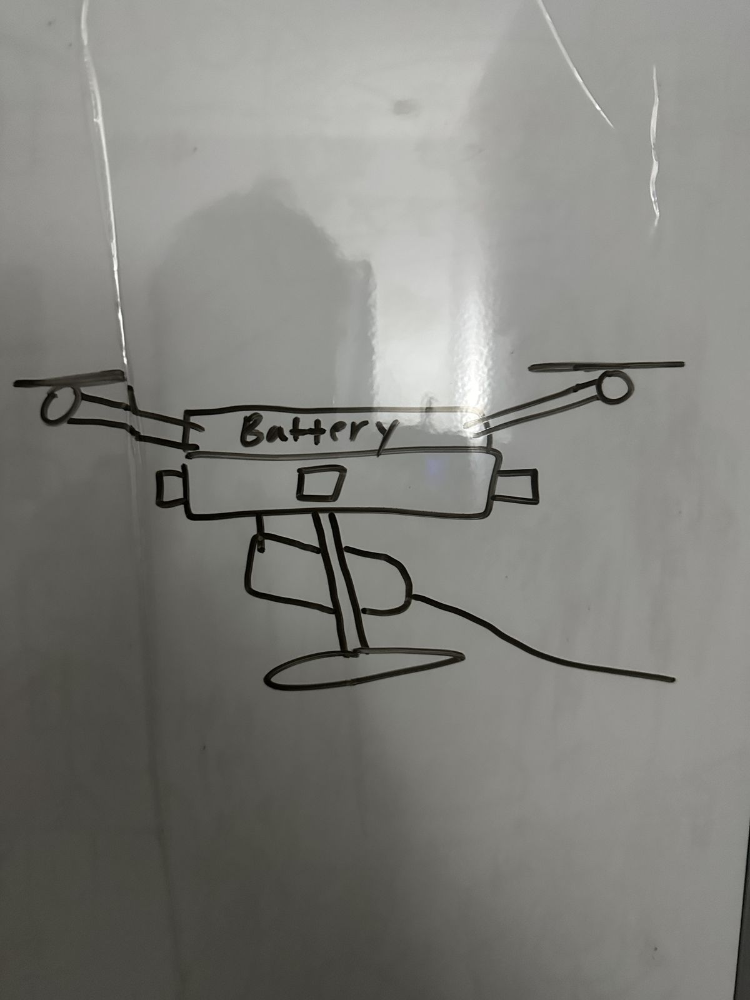

# Tunnel-Scout

TunnelScout is a fiber-tethered inspection drone for caves and underground mines. A 50 m single-mode
fiber tether carries control, telemetry and video between the drone and a ground laptop, so it keeps
working where rock blocks radio. The drone carries a low-light (NoIR) camera with IR lighting, a 360° lidar
for mapping, time-of-flight collision sensors and gas sensors for checking the air before people go in.

UF Computer Engineering capstone, CEN3907C, Fall 2026. Faculty: Prof. Jeremiah Blanchard. TA: Minh Tran.
Test site: Warren Cave Nature Preserve (National Speleological Society).



## Team

| Name | Discord |
| --- | --- |
| Hope Carter | hup |
| Alexander (Alex) Hommerding | moon |
| Roberto Zaldana-Arguello | royboitoe |
| Gabriel Bendix | Gabe |

## Current hardware

7-inch Readytosky 295 mm frame · 4× EMAX ECO II 2807 motors · HQProp 7×4×3 props ·
MicoAir743 V2 flight controller + AM32 55A 4-in-1 ESC (ArduCopter) · 6S battery ·
Raspberry Pi 5 companion computer (MAVProxy) · Pi Camera Module 3 Wide NoIR + 850 nm IR boards ·
Slamtec RPLIDAR C1 · Adafruit VL53L1X ToF sensors · MQ-9 / MQ-135 gas sensors ·
fiber media converters + 50 m fiber · QGroundControl on a laptop with an Xbox (now TBS Tango II) controller.

## Repo layout

```
README.md            this file
code/                scripts that run on the Raspberry Pi (see code/README.md)
  camera/              ir-cam.py: NoIR camera MJPEG stream
  sensors/             tof-sensor.py: VL53L1X distance sensor
docs/
  how-to/              team How-To Doc (SSH, sensors, camera, MAVLink)
  parts-and-expenses/  parts and expenses list
  reports/             semester work report
  design/              concept sketches, renders and wiring diagrams
project-updates/     daily updates, one folder per Mon–Sun week (see project-updates/README.md)
```

## How to post an update

1. Copy [`project-updates/TEMPLATE.md`](project-updates/TEMPLATE.md) into this week's folder as
   `YYYY-MM-DD.md`. If the file already exists, add your own `## Name` section.
2. Put photos and files in that week's `assets/` folder as `YYYY-MM-DD_description.ext`
   (lowercase, dashes, no spaces). Keep photos under 1600 px.
3. Commit as `update: YYYY-MM-DD <name> <what>`, for example
   `update: 2026-11-13 Hope tether flight test`, then push.
4. Every Sunday, someone writes that week's `WEEKLY-SUMMARY.md`.
