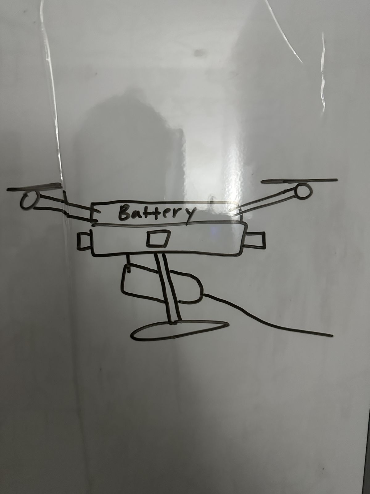

# Saturday, Aug 29

Roberto sketched the first idea for the drone on a whiteboard.

## Roberto

- Drew the first concept sketch of the drone layout, including where the battery goes (photo 8:10 PM).

## Pics & files

*First concept sketch (8:10 PM)*

## Sources

- Drive: `Tunnel Scout/Roberto_s Media/Pre 11_10/IMG_8318.JPG` (EXIF 2026-08-29 20:10)
- Roberto's work report, Fig 1: [work report](../week-12-nov-09-to-nov-15/2026-11-10_tunnelscout-work-report-fall-2026.pdf)
