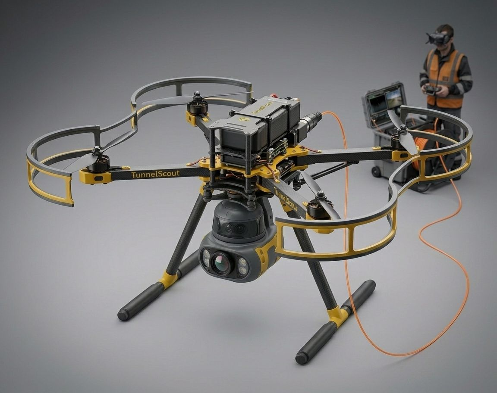

# Week 3 (Sep 7 – 13)

Pitch week. Roberto put together the **P0 Project Pitch**: a one-line pitch, a use-case story, the tech write-up, a narration script, a render, and a 45–60 second narrated video. It was due and submitted by Sep 11.

Roberto's notes say he made product renders with Gemini image generation. This one is in his Drive folder but has no date in the file, so it may or may not be the pitch render:

*From Roberto's [work report](../week-12-nov-09-to-nov-15/2026-11-10_tunnelscout-work-report-fall-2026.pdf), pp. 3, 6–7.*
