# Friday, Oct 9

Roberto researched the fiber tether and ordered the 50 m fiber. He also wrote up drone-build research notes for the team.

## Roberto

- Researched the tether and spool (1:36–2:10 PM):
  - fishing reels with line counters for the spool
  - fiber cable types (G.652 vs G.657) and single-mode 1310/1550 nm bend-insensitive fiber
  - SFP modules and fiber media converters
- Ordered a 50 m SC/UPC G.657A2 fiber patch cord (about $20).
- Posted drone-build notes in #parts_list (2:54 PM):
  - 7-inch frame for flight time and stability
  - LiPo vs Li-ion packs
  - an integrated FC + ESC stack
  - soldering motors and power leads
  - Betaflight safe modes
  - buying spare motors for crashes
  - Joshua Bardwell's guides as a reference
- Later notes (10:28 PM): monitor, obstacle-avoidance sensors, drone makers, and the need for a licensed pilot.

## Problems / what's next

- 50 m single-mode fiber chosen and ordered for the tether.

## Pics & files

*Fishing reel research for the tether spool (1:36 PM)*
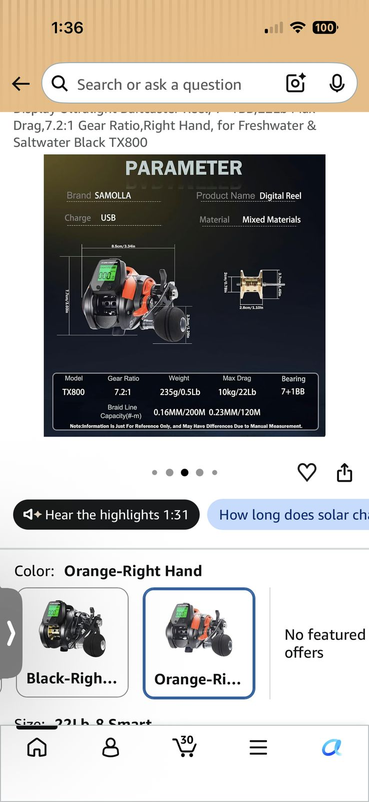

*Reel with a line counter, a spool option (1:37 PM)*
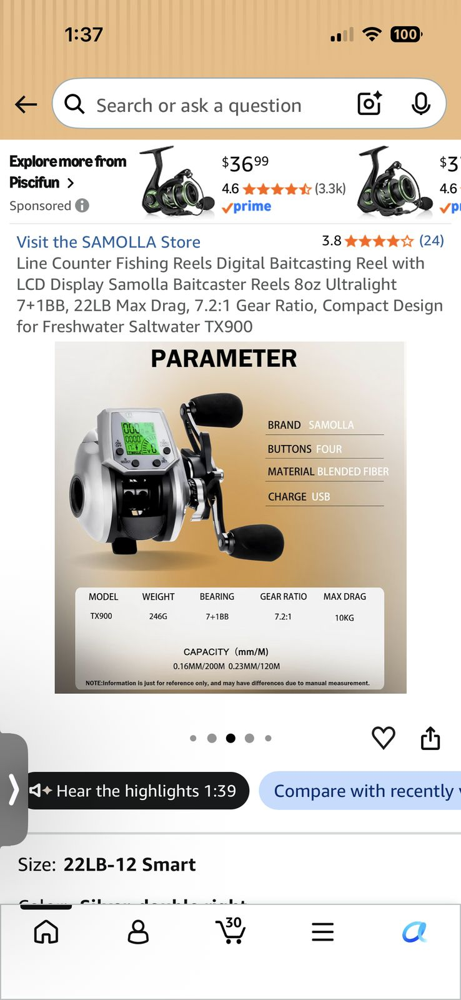

*Optical fiber spool listing (1:47 PM)*
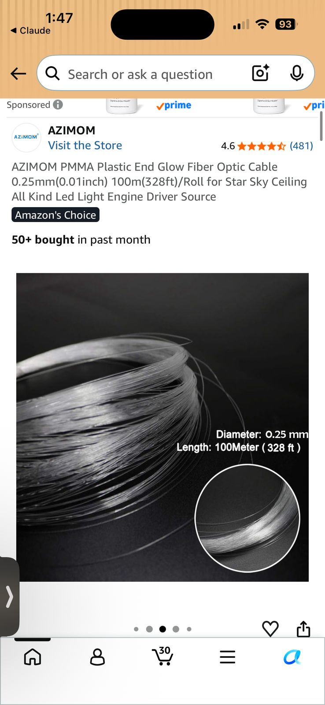

*SFP fiber transceiver modules (1:47 PM)*
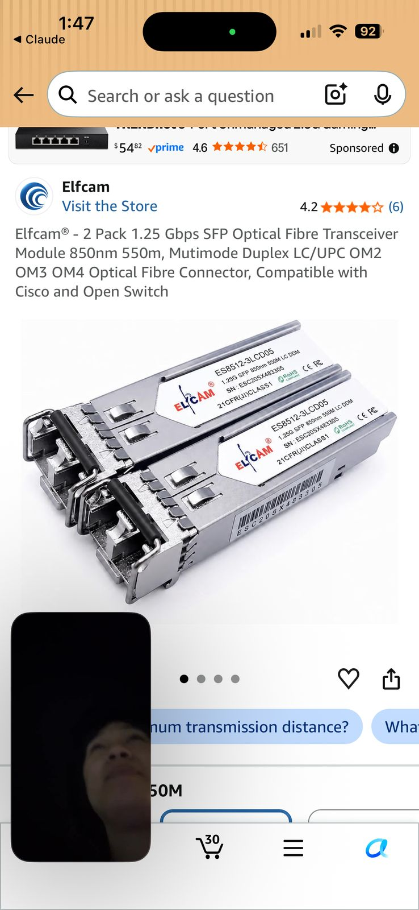

*Fiber cable types, G.652 vs G.657 (1:50 PM)*
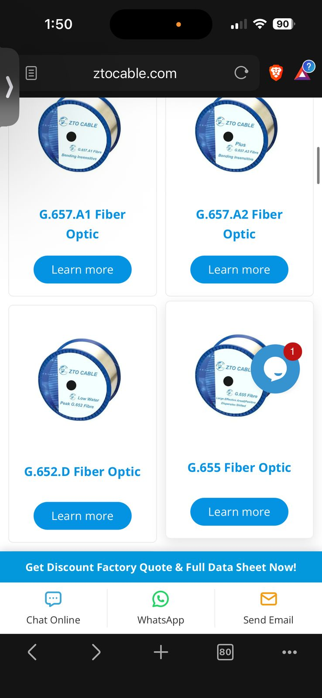

*Fiber cable types, continued (1:50 PM)*
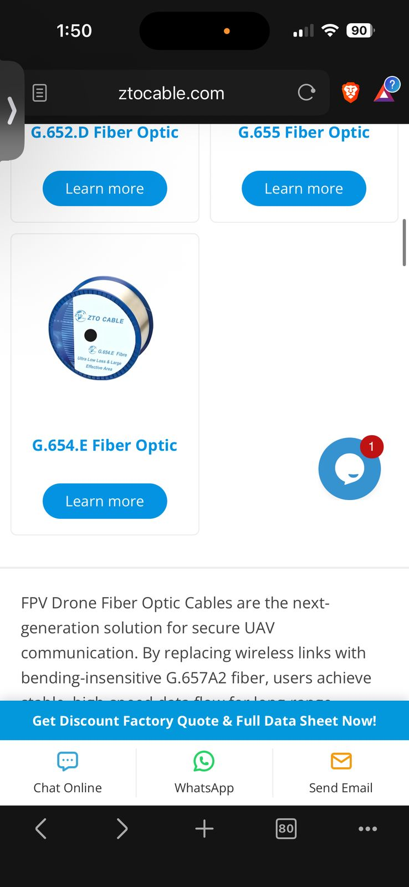

*Single-mode bend-insensitive fiber (1:53 PM)*
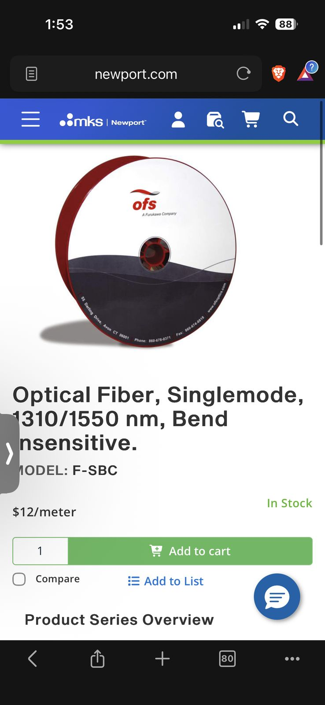

*SC/UPC G657A2 patch cord listing (1:56 PM)*
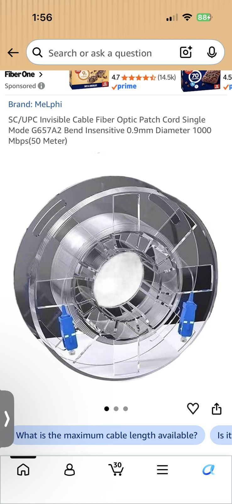

*Patch cord options (2:03 PM)*
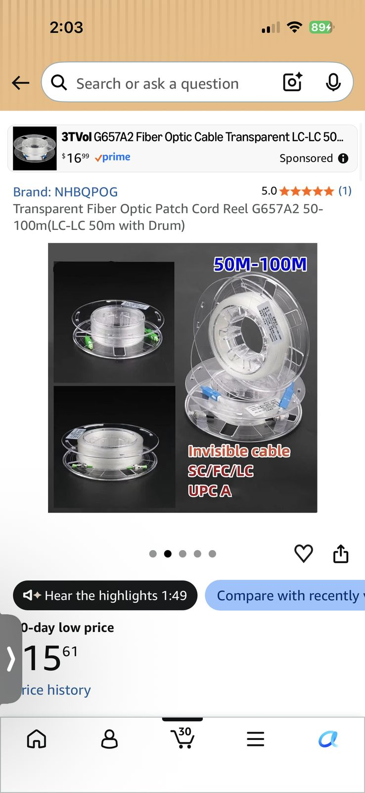

*Fiber patch cord order, 50 m single-mode (2:08 PM)*
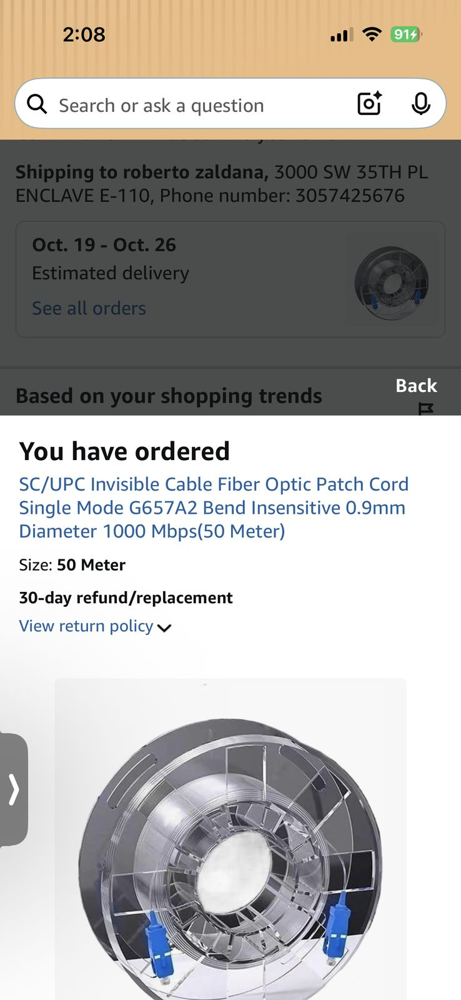

*Fiber media converter listing (2:10 PM)*
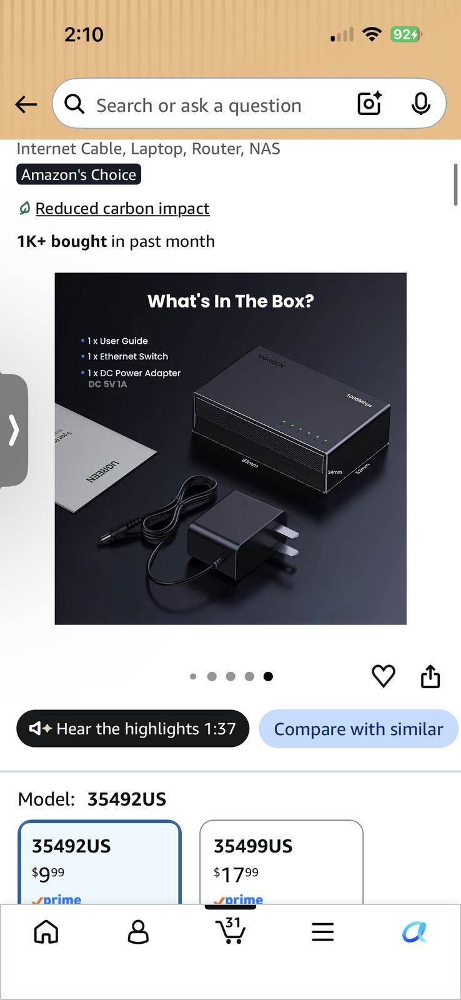

## Sources

- Discord #parts_list, 2026-10-09 14:54, 14:56, 14:59, 22:28 (royboitoe)
- Drive: `Tunnel Scout/Roberto_s Media/Pre 11_10/IMG_8641.PNG` … `IMG_8651.PNG` (EXIF 2026-10-09 13:36–14:10)
- Roberto's semester work report, Figs 9–19: [work report](../week-12-nov-09-to-nov-15/2026-11-10_tunnelscout-work-report-fall-2026.pdf)
- Drive: `Tunnel Scout/Roberto_s Media/Pre 11_10/IMG_8650.PNG`
