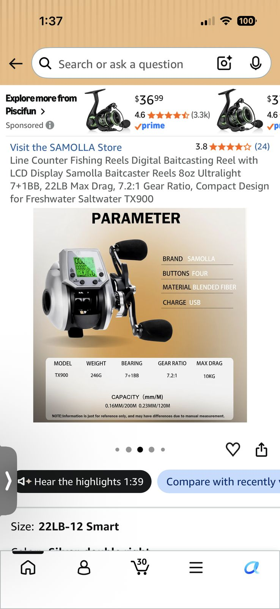

# Week 7 (Oct 5 – 11)

All hands on the R1 Design Draft:

- Roberto did the network, interface, schematics and mockup sections.
- Gabriel did the storyboard.
- Alex wrote the two missing sections.
- Hope wrote the intro.

We went over the word limit, cut it back under 1,500, and Roberto submitted it on Thursday. That same day we had our first stakeholder meeting with the TA in the lab.

The Warren Cave manager wrote back offering an area near the entrance, and Roberto proposed Sat Nov 7. Roberto ordered the 50 m fiber for the tether on Friday, and Hope made the parts and weight spreadsheet on Sunday.

Days: [Mon 10/5](2026-10-05.md) · [Tue 10/6](2026-10-06.md) · [Wed 10/7](2026-10-07.md) · [Thu 10/8](2026-10-08.md) · [Fri 10/9](2026-10-09.md) · [Sun 10/11](2026-10-11.md)

*From Discord #general, #parts_list, #cave_info and Roberto's [work report](../week-12-nov-09-to-nov-15/2026-11-10_tunnelscout-work-report-fall-2026.pdf).*
