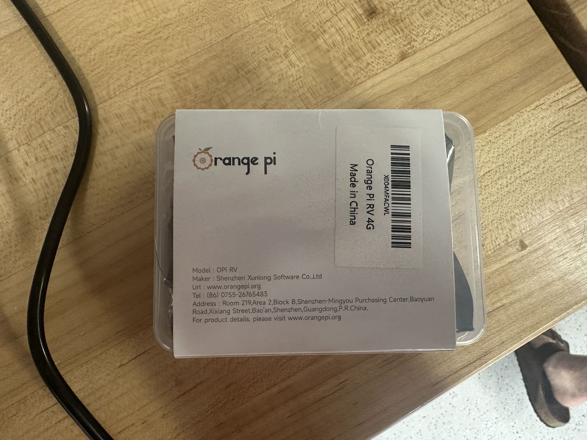
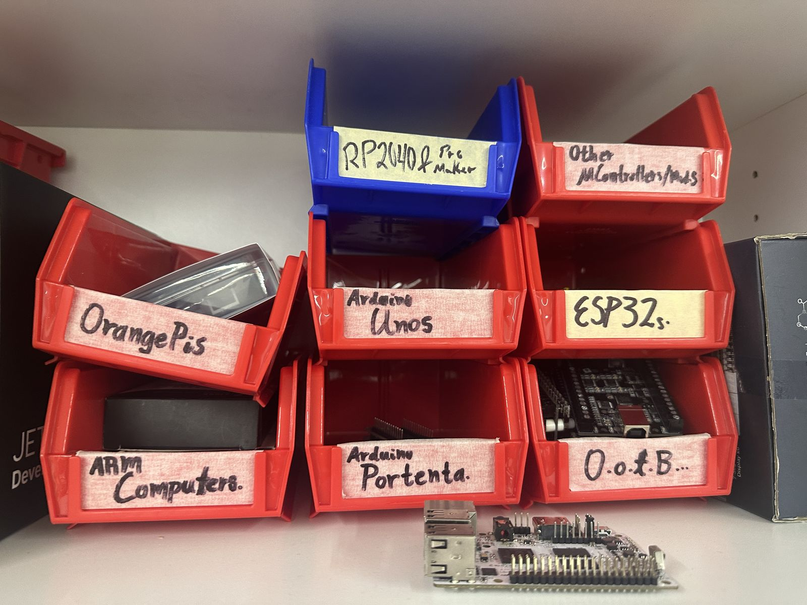

# Thursday, Oct 15

Stakeholder meeting with the TA in the lab. Roberto was there in person, and Alex and Gabriel said they'd join online. Roberto checked the lab's spare parts and answered the cave manager.

## Hope

- Proposed a Sunday-evening team call after the meeting (12:08 PM).

## Alex

- Joined the meeting online and posted the discussion points (11:40–11:46 AM):
  - the weight vs flight-time tradeoff
  - the parts funding request
  - weight management
  - mounting the 2D lidar vertically to take cross-sections of the cave and rebuild a 3D map using IMU data

## Roberto

- Waited with the team for the TA, who was with another group (11:15 AM).
- Checked the lab parts bins (Orange Pi, Arduino, ESP32, Portenta) for parts the team could use (photos 12:10 PM).
- Replied to the Warren Cave manager with team size and gear plan (5:05 PM). Posted the cave trip screenshots: "I think we got it" (5:08 PM).

## Gabriel

- Joined online for the stakeholder meeting ("I'm waiting in general", 11:05 AM).

## Problems / what's next

- Idea from the meeting: a vertical 2D lidar plus IMU for 3D cross-section mapping.

## Pics & files

*Lab parts bin checked for usable parts*

*More lab parts bins: Orange Pi, Arduino, ESP32, Portenta (12:10 PM)*

## Sources

- Discord #general, 2026-10-15 10:25–12:56 (aleqbr, gabe.bend, royboitoe, hup714), 17:08 (royboitoe)
- Drive: `Tunnel Scout/Roberto_s Media/Pre 11_10/IMG_8721.JPG`, `IMG_8722.JPG` (EXIF 2026-10-15 12:10)
- Roberto's semester work report, Figs 20–21 and p. 7 (reply 5:05 PM): [work report](../week-12-nov-09-to-nov-15/2026-11-10_tunnelscout-work-report-fall-2026.pdf)
