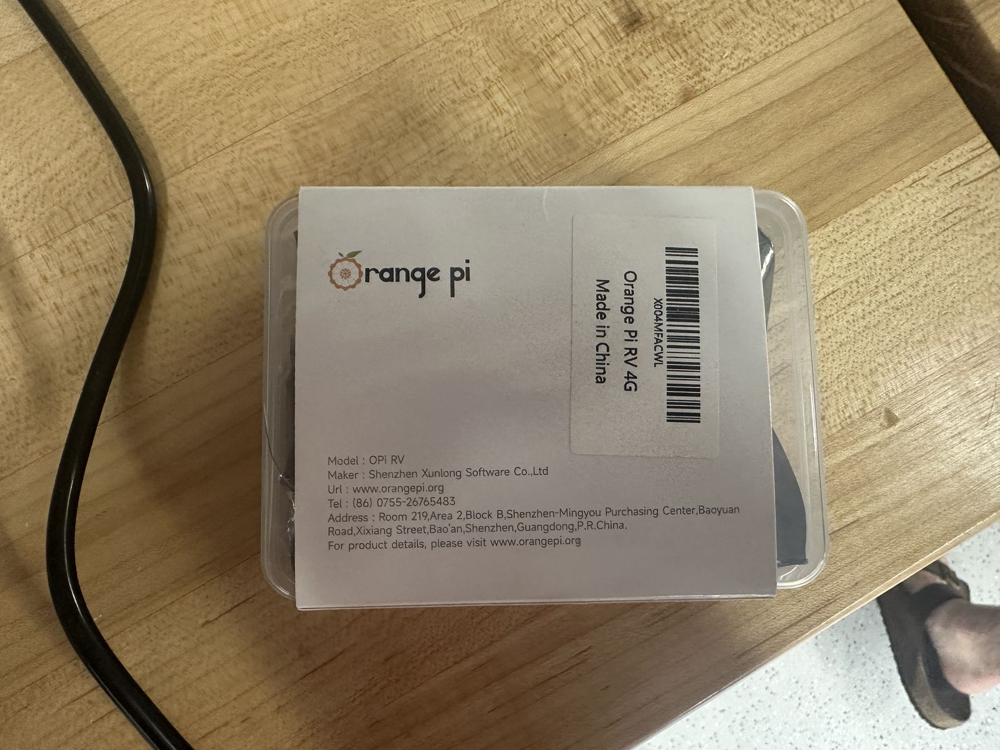

# Week 8 (Oct 12 – 18)

First parts orders went in, and then mostly we were **waiting on parts**. Roberto bought the first batch and worked out the weight (about 1.4 kg) and flight time (about 15 min). He also compared a cheap LiPo with a longer-lasting Li-ion. Hope's gas sensors came in Monday, and she got the first MQ-9 readings on an Arduino. The frame showed up Wednesday.

At Thursday's stakeholder meeting, Alex brought up mounting the 2D lidar vertically so it maps the cave in cross-sections. Roberto checked the lab bins for parts we could use. On Friday the cave trip was confirmed for **Nov 7**.

Days: [Mon 10/12](2026-10-12.md) · [Tue 10/13](2026-10-13.md) · [Wed 10/14](2026-10-14.md) · [Thu 10/15](2026-10-15.md) · [Fri 10/16](2026-10-16.md) · [Sun 10/18](2026-10-18.md)

*From Discord #general, #parts_list and Roberto's [work report](../week-12-nov-09-to-nov-15/2026-11-10_tunnelscout-work-report-fall-2026.pdf).*
