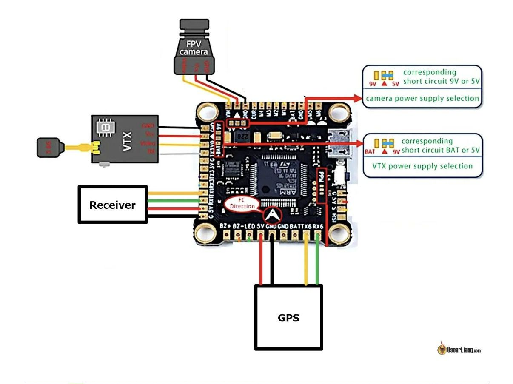

# Week 9 (Oct 19 – 25)

Still **waiting on parts**, so this was a paperwork and decisions week. The R1 draft came back 50/50; the TA asked us to draw our own mockup diagrams next time. We went with a Raspberry Pi 4 for the purchase request, and the TA is covering all three lidars.

Roberto updated the final design draft, Hope edited it, and we reviewed it on a Friday night Discord call and submitted it. Alex asked why we had two BECs, and Roberto's power diagram showed one RMRC 8A is enough. Gabriel found a matching 6S Li-ion battery, and Roberto ordered the motors.

Days: [Tue 10/20](2026-10-20.md) · [Wed 10/21](2026-10-21.md) · [Thu 10/22](2026-10-22.md) · [Fri 10/23](2026-10-23.md) · [Sat 10/24](2026-10-24.md)

*From Discord #general, #parts_list and Roberto's [work report](../week-12-nov-09-to-nov-15/2026-11-10_tunnelscout-work-report-fall-2026.pdf).*
