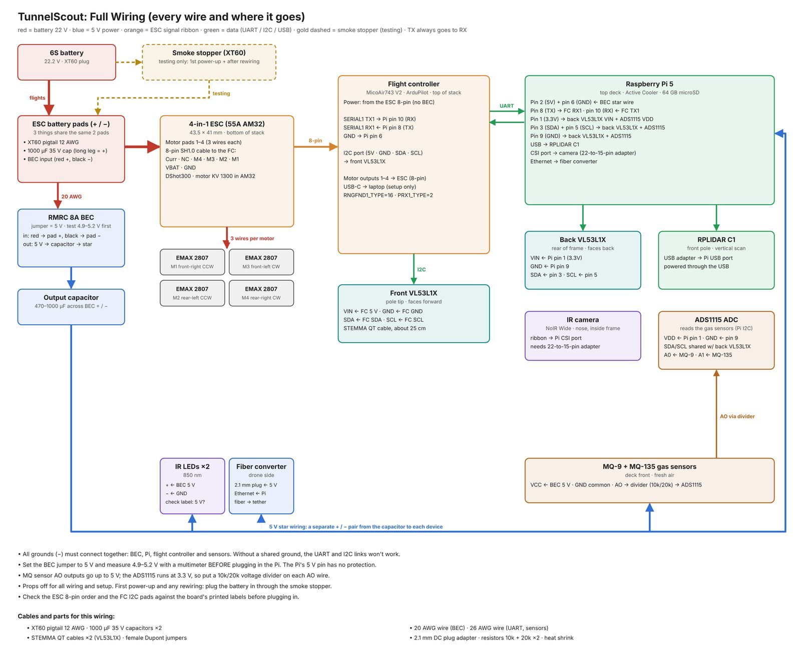

# Monday, Oct 26

Roberto finalized the BEC choice and the wiring parts checklist, and shared the full wiring diagrams for review. Hope set up the next stakeholder meeting.

## Hope

- Announced the stakeholder meeting for Thu Oct 29, 11 AM – 12 PM in the lab (8:04 PM, #announcements).
- Listed what to check the lab for at the meeting: screw and standoff sets, zip ties, an ADC (8:16 PM).

## Roberto

- Picked the **RMRC 8A/12A UBEC** set to 5 V, one unit (7:38 PM). Reasons: $12.99, 21 g, 8 A continuous covers the
  about 5.7 A load, and it's in stock. It beat the Matek UBEC DUO (discontinued), HobbyWing 5A Air (too small),
  HobbyWing 10A V2 (6 V minimum) and Matek BEC12S-Pro (back-ordered, 5 A).
  Install notes: check 5 V with a multimeter before connecting the Pi, add a 470–1000 µF output cap,
  and give the Pi its own wire.
- Wrote the wiring parts checklist (7:53 PM): XT60 pigtail, 1000 µF 35 V ESC cap, battery straps, M2.5 nylon kit,
  M3 standoffs, DC plug adapter and wire. Also recommended a Flywoo 6S Li-ion, a smoke stopper and a LiPo bag.
- Shared the full-system wiring diagrams and asked Alex and Gabriel to review them (9:02 PM).

## Problems / what's next

- One RMRC 8A UBEC at 5 V. The full 6S charge (25.2 V) is close to its 26 V maximum, so keep the ESC capacitor.

## Pics & files

*Full wiring diagram (every wire)*

## Sources

- Discord #general, 2026-10-26 19:38, 19:53, 21:02 (royboitoe); 20:16 (hup714). Attachments: `TunnelScout_Full_System_Wiring.png`, `TunnelScout_Full_Wiring.png`
- Discord #announcements, 2026-10-26 20:04 (hup714)
- Drive: `Tunnel Scout/TunnelScout_Full_Wiring.png` (same file as the 9:02 PM Discord attachment, 728 KB)
- Roberto's semester work report, p. 5: [docs/reports](../week-12-nov-09-to-nov-15/2026-11-10_tunnelscout-work-report-fall-2026.pdf)
