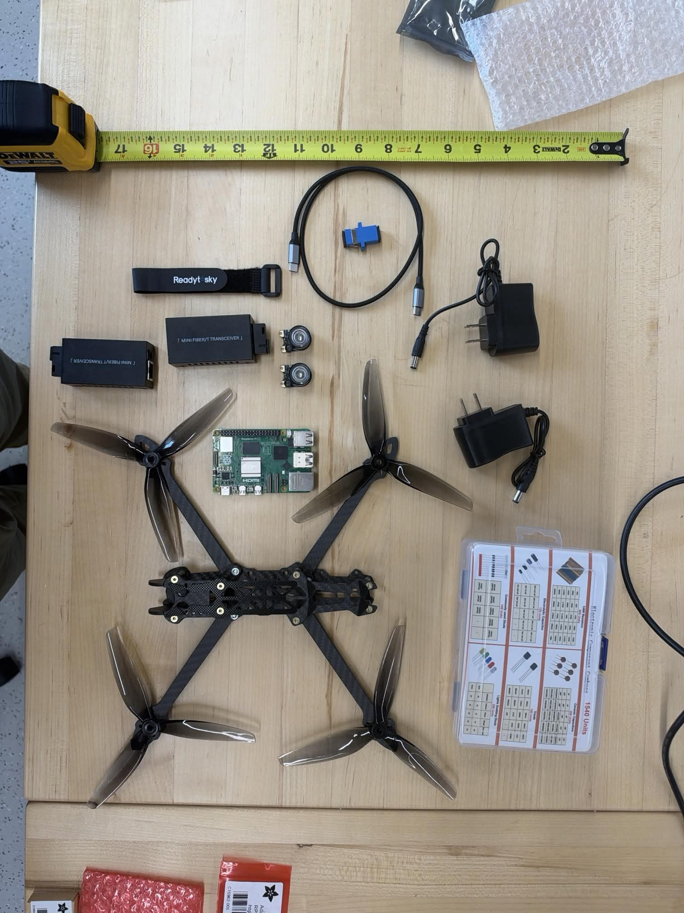
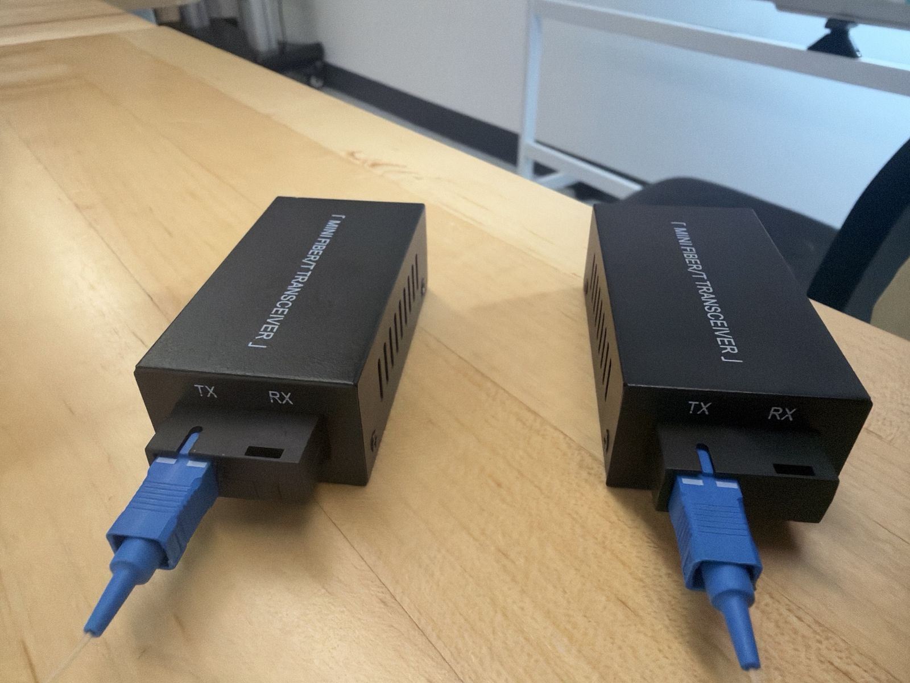
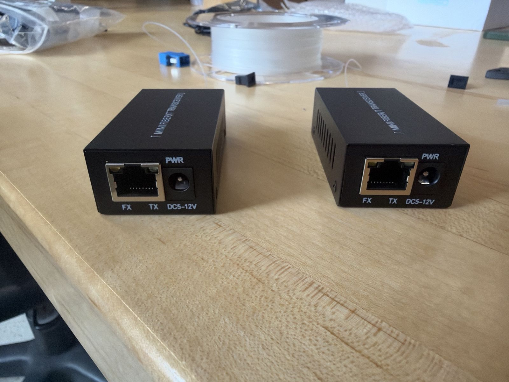

# Wednesday, Oct 28

Roberto was in the lab checking the parts that had arrived. The fiber media converters linked up, and he posted the final buy list.

## Hope

- Tracked the deliveries: flight controller due in a day, 360° lidar and collision sensors coming with Roberto's order (3:47–4:16 PM).

## Roberto

- In the lab at 4:16 PM: connected the pair of fiber media converters and confirmed they link ("They connect").
- Did a parts fit check, including the Raspberry Pi on the drone frame.
- Posted what was left to buy before the build could start (4:33–4:36 PM):
  - RMRC 8A UBEC
  - CNHL 3300 mAh 6S LiPo
  - Raspberry Pi Active Cooler
  - 64 GB microSD
  - carbon fiber tube
- Shared a photo of everything on hand (4:34 PM).

## Problems / what's next

- Five items left to buy before building.

## Pics & files

*Parts on hand (4:34 PM). An identical copy was also in the repo: duplicate.*

*Fiber-to-Ethernet converters (4:16 PM)*

*Converters linked with the fiber*

*The two fiber-to-Ethernet converters (no date in the file)*

## Sources

- Discord #build_drone, 2026-10-28 16:16 (royboitoe). Attachments: `photo.jpg` (118.9 KB), `photo.jpg` (141.98 KB)
- Discord #general, 2026-10-28 12:38–16:36 (royboitoe), 15:47–16:16 (hup714). The 16:34 attachment `photo.jpg` (235.68 KB) matches the repo's `Drone parts day1.jpg` / `photo.jpg`
- Drive: `Tunnel Scout/Roberto_s Media/Pre 11_10/photo(2).jpeg`, `photo.jpeg`; `Tunnel Scout/Gabriel_s Media/Pre 11_10/photo.jpg`, `photo(1).jpg` (byte-identical to the repo photos)
- Roberto's semester work report, p. 5 ("In lab at 4:16 PM: parts fit check, remaining buy list"): [work report](../week-12-nov-09-to-nov-15/2026-11-10_tunnelscout-work-report-fall-2026.pdf)
- Drive: `Tunnel Scout/Roberto_s Media/Pre 11_10/photo(1).jpeg`
