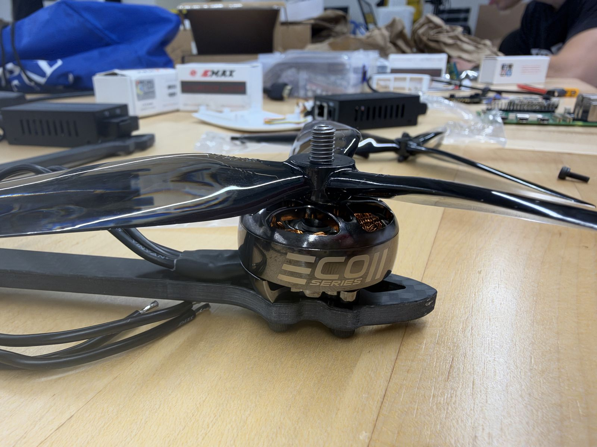
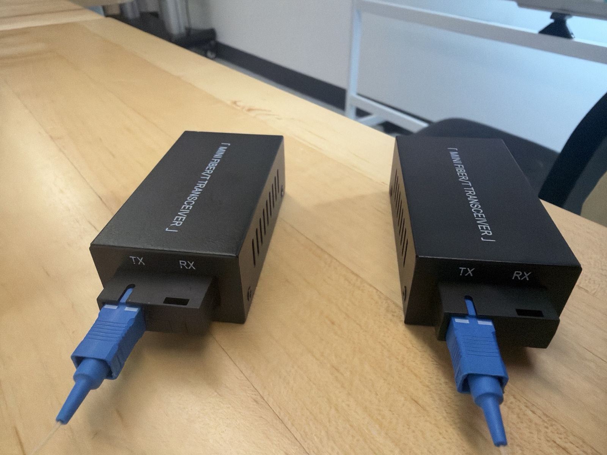

# Week 10 (Oct 26 – Nov 1)

**Parts started showing up.**

- Tuesday: Hope picked up the Pi.
- Wednesday: Roberto got the fiber converters talking to each other.
- Thursday: the flight controller arrived, and Roberto mounted the motors on the frame.
- Sunday: Alex said the BEC had come in.

Roberto picked the BEC and drew the full wiring diagram. We booked **Dec 3** for the prototype presentation. Everyone signed the cave release forms, and on Sunday we planned the first real build day.

Days: [Mon 10/26](2026-10-26.md) · [Tue 10/27](2026-10-27.md) · [Wed 10/28](2026-10-28.md) · [Thu 10/29](2026-10-29.md) · [Fri 10/30](2026-10-30.md) · [Sun 11/1](2026-11-01.md)

*From Discord #general, #build_drone, #parts_list and Roberto's photos and [work report](../week-12-nov-09-to-nov-15/2026-11-10_tunnelscout-work-report-fall-2026.pdf).*
