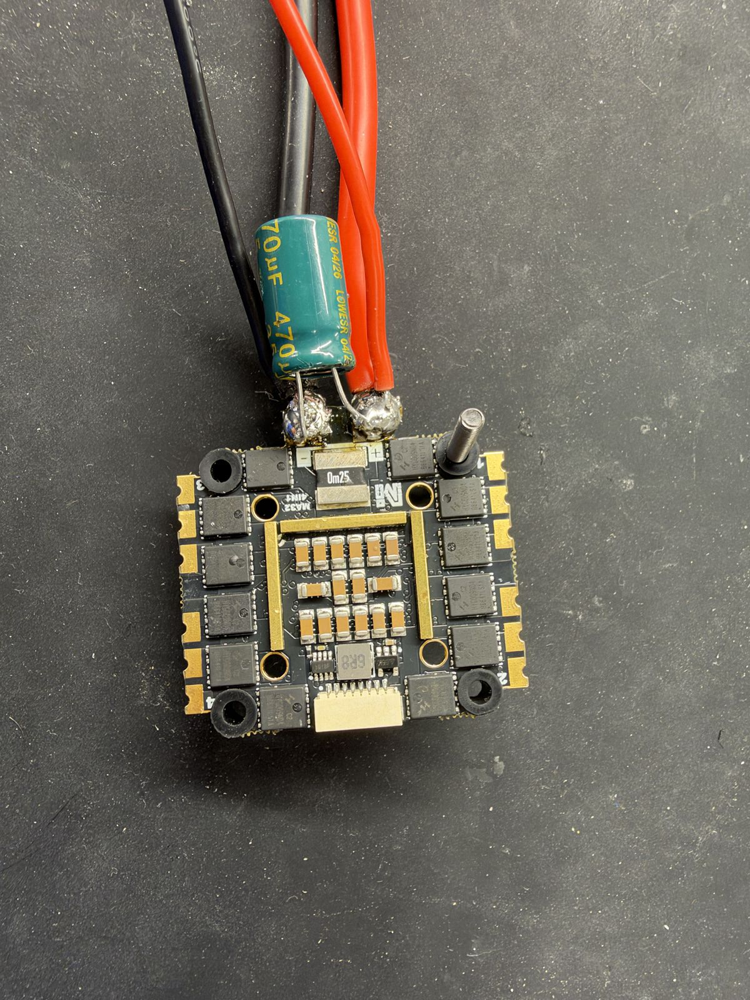
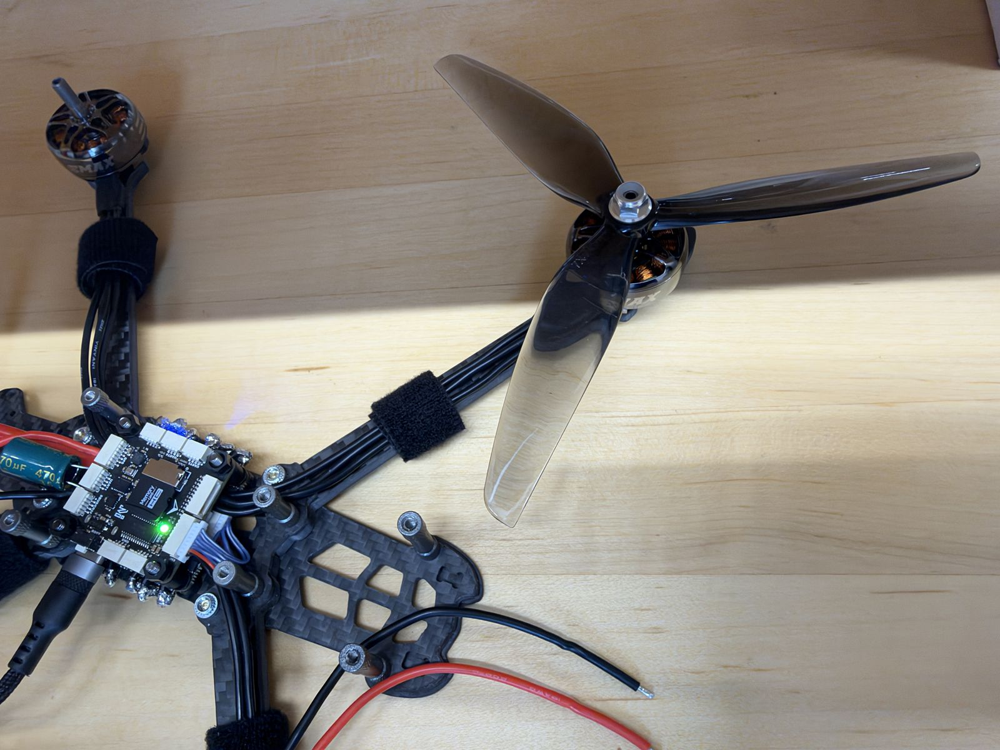
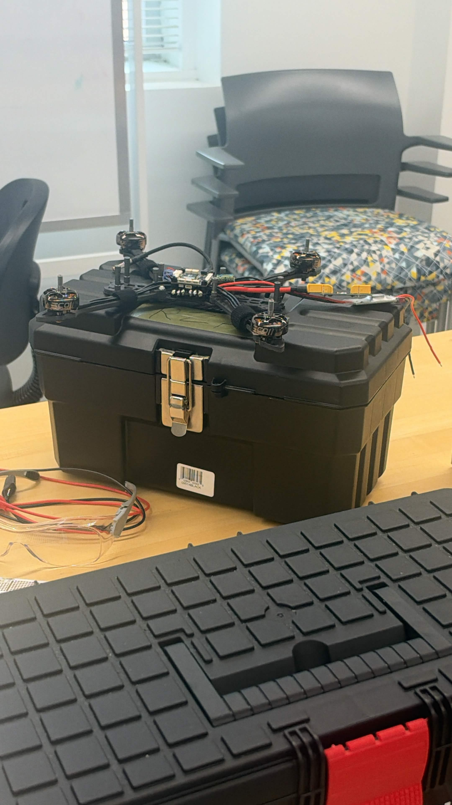
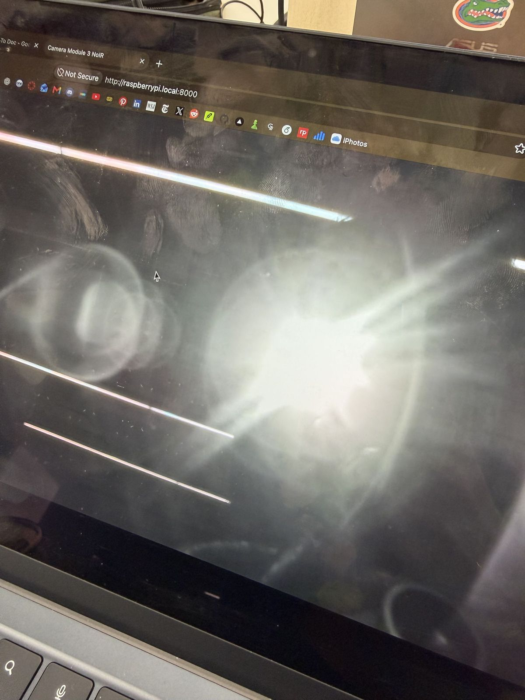
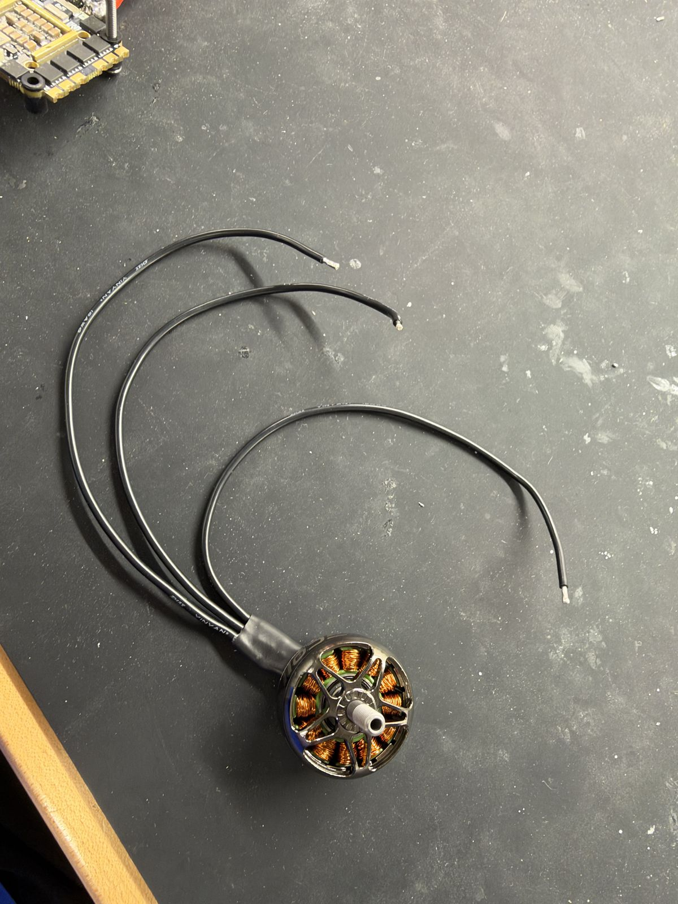
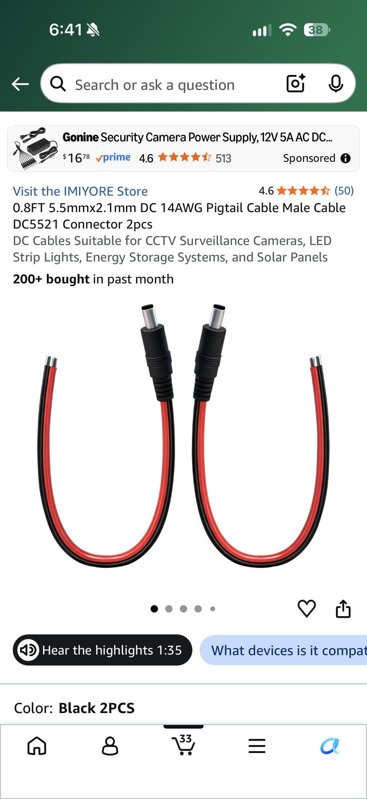
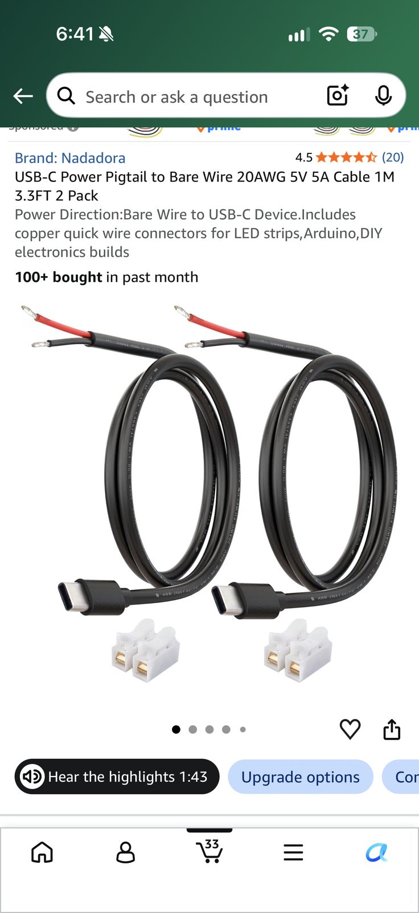

# Tuesday, Nov 3

All four motors were soldered to the ESC, tested and working, and the drone was assembled. The NoIR camera streamed live video from the Pi.
Hope started the team How-To Doc, Roberto programmed the FC motor outputs and drew the power diagram, and Gabriel brought up the camera and IR boards from a Mac.

## Hope

- Pinned a tip: plugging a new device into the Pi while it's on resets the connection, so you have to SSH again (11:54 AM).
- Started the **TunnelScout How-To Doc** with SSH, ToF sensor and camera steps (Google Doc, 12:37 PM). Exported later as [How-To Doc v1](../../docs/how-to/how-to-doc-v1.pdf).
- Got live video from the IR camera (2:14 PM). Her camera reports cover how:
  - raw H.264 over TCP into VLC only showed a still frame
  - `--libav-format h264` fixed the stdout output error
  - the picamera2 MJPEG server, which became [`ir-cam.py`](../../code/camera/ir-cam.py), works in a browser on port 8000
- Followed up when the Pi stopped answering at `192.168.137.80` the day after setup, per her Pi setup summary.

## Alex

- Posted the camera still-capture command, `rpicam-still -n -o test.jpg` (12:45 PM). It's now in the How-To Doc.

## Roberto

- In the lab at 10:32 AM with everything set up. Identified the XT60 smoke stopper for the first power-up (10:40 AM).
- Soldered the motors to the ESC, mapped each pad group to its frame corner and spin direction, and made an annotated ESC pad photo (11:08 AM – 12:22 PM).
- Assembled the drone (2:50 PM). Reported all motors soldered and tested working (3:14 PM).
- Planned the IR LED board polarity test with the bench supply (4:03 PM) and a BEC + LED breadboard test (5:44 PM).
- Programmed the FC motor outputs on QGroundControl's Servo Outputs page (5:48–6:04 PM).
- Worked out Pi power options and the full power budget, including the Pi's 3.3 V limit of about 500 mA. Made a labeled power and signal diagram (6:07–6:34 PM).
- Planned the build order for mounting parts and a barrel-jack pigtail for the fiber converter (6:36–6:42 PM).
- Posted a poll for a Saturday 10 AM meeting time (8:04 PM).

## Gabriel

- Came in during the afternoon.
- Brought up the Pi from his Mac with Claude (4:30–5:25 PM):
  - Reached it over SSH at `raspberrypi.local` with macOS Internet Sharing. The Pi was at `192.168.2.2`, since `.137.80` is the Windows ICS subnet.
  - Ran `irCam.py`, which detected the IMX708 Wide NoIR and streamed 1280×720 to port 8000.
  - Set the Pi 5 fan to run at full speed all the time in `config.txt`.
  - Bench-tested one IR LED board: lit at about 100 mA at 3.3 V. Planned wiring both boards in parallel to pins 1 and 6.
  - Dark-toolbox test came out black, which points to the IR boards not being lit on the Pi yet.
- Posted a photo of the IR camera stream working (5:21 PM).

## Problems / what's next

- Gabriel said at 2:15 PM that he'd solder the motor phases that night. Roberto reported at 3:14 PM that he had already soldered and tested all of them.
- The IR boards can't screw onto the Camera Module 3, so they need their own bracket and GPIO power.
- Connect to the Pi by hostname (`raspberrypi.local`), since its IP changes with the host laptop.

## Pics & files

- [How-To Doc v1](../../docs/how-to/how-to-doc-v1.pdf)

*ESC with motor wires and capacitor soldered (11:06 AM)*

*Drone assembled with motors and props (2:50 PM)*

*Drone with motors and FC on the lab toolbox (4:01 PM) (posted in #build_drone on Nov 4 at 6:20 PM)*

*IR camera stream working on Gabriel's laptop (5:21 PM)*

*Motor wires prepped for soldering (11:06 AM)*

*USB-C and DC barrel pigtail listing (6:41 PM)*

*Pigtail listing (6:41 PM)*

## Sources

- Discord #general, 2026-11-03 10:32–20:04 (royboitoe, hup714, aleqbr, gabe.bend). The 17:21 attachment is `5CBB7798-9E7D-4A75-B22A-11F12DB26129.jpg`
- Discord #announcements, 2026-11-03 20:04 (royboitoe)
- Drive: `Tunnel Scout/Roberto_s Media/Pre 11_10/IMG_8917.JPG` – `IMG_8925.PNG`, `F31FE802-66F2-44C1-82FD-23B0F38570DE.jpg` (EXIF 2026-11-03 11:06–18:41)
- Drive: `Tunnel Scout/Gabriel_s Media/Pre 11_10/5CBB7798-9E7D-4A75-B22A-11F12DB26129.jpg`
- Drive: `Tunnel Scout/Hope_s Media/Pre 11_10/Raspberry Pi Camera Module 3 NoIR Wide Live Video Setup Report.pdf`, `Raspberry Pi IR Light and Live Camera Setup Chat Summary.pdf`, `pi_camera_streaming_report.pdf`, `Raspberry Pi 5 Setup Summary.pdf`
- Claude summary: `TunnelScout Pi Camera and IR Bring-Up Log.docx` (Nov 3, 4:30–5:25 PM)
- Roberto's semester work report, pp. 8, 15–16 (Figs 83–88): [work report](../week-12-nov-09-to-nov-15/2026-11-10_tunnelscout-work-report-fall-2026.pdf)
