# Thursday, Nov 5

Stakeholder meeting at 11 AM. Afterwards the team powered the Pi from the lab bench supply, checked the flight controller, and found why the BEC was putting out 7.7 V instead of 5 V.

## Alex

- Tracked the flight battery delivery. It arrived later in the day than expected (9:03 and 10:15 AM).
- Posted a photo in #general (2:37 PM). The file isn't in the archive.

## Roberto

- Attended the 11 AM stakeholder meeting.
- Powered the Pi from the Rigol bench supply through a USB-C pigtail: 5.0 V, 0.94 A at boot (11:58 AM).
- Ordered GPIO header extenders and standoffs, zip ties, a DC barrel pigtail and a USB-C pigtail (12:23–12:24 PM).
- Checked the FC and its parameters (1:10–1:13 PM).
- Measured about 7.7 V from the BEC and traced it to all three voltage jumpers being installed.
- Reviewed the Warren Cave map. Told the team the first spot to check is Chicken Grotto, and to bring a change of clothes (11:54–11:58 PM).

## Gabriel

- In the lab for the meeting (11:03 AM). Took 11 photos in the lab between 11:20 AM and 12:19 PM (see below).
- Started putting the team's images into the Google Drive (1:14 PM).

## Problems / what's next

- BEC: only one voltage jumper may be installed. The next day the team set it to 5 V.
- The battery arrived. The team will bring it to the lab the next day.

## Pics & files

- Gabriel's photos from 11:20 AM to 12:19 PM are screenshots of the original HEIC files. The six-shot burst at 12:19 is cut down to three.

*Drone and electronics laid out on the bench (11:20 AM)*
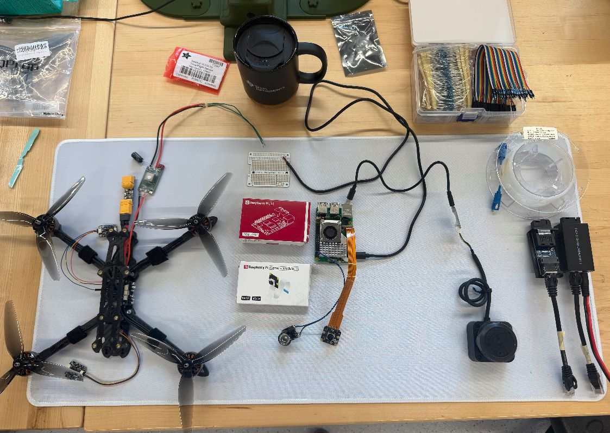

*Drone on the bench, another angle (11:23 AM)*
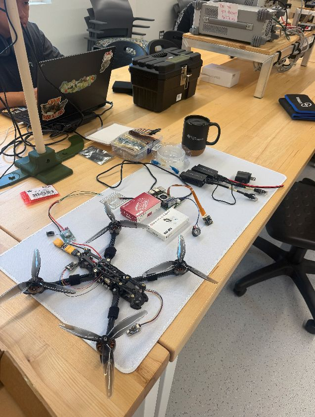

*BEC board with the capacitor (11:58 AM)*
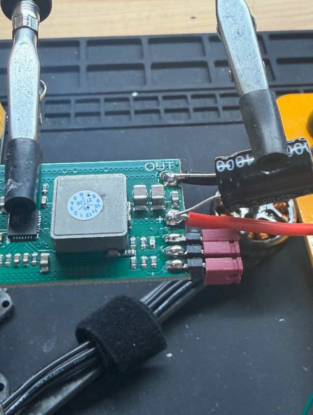

*BEC board with the capacitor, closer (12:04 PM)*
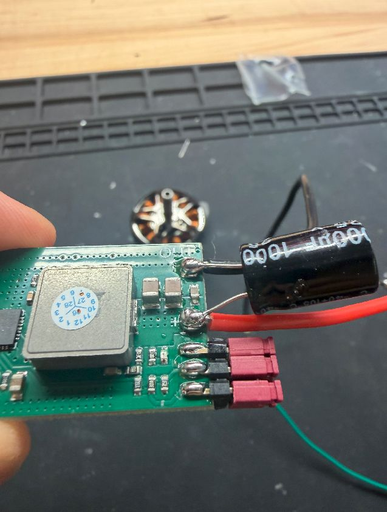

*BEC held in the helping hands, 7–26 V in / 5–7.4 V out (12:06 PM)*
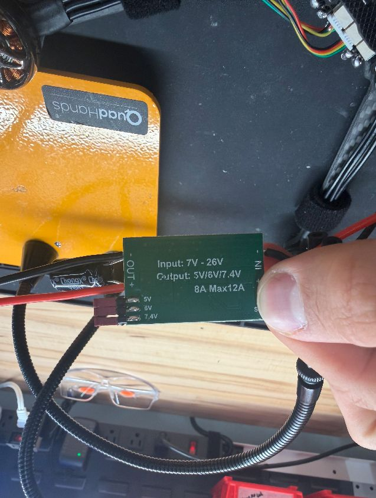

*Soldering at the bench (12:19 PM)*
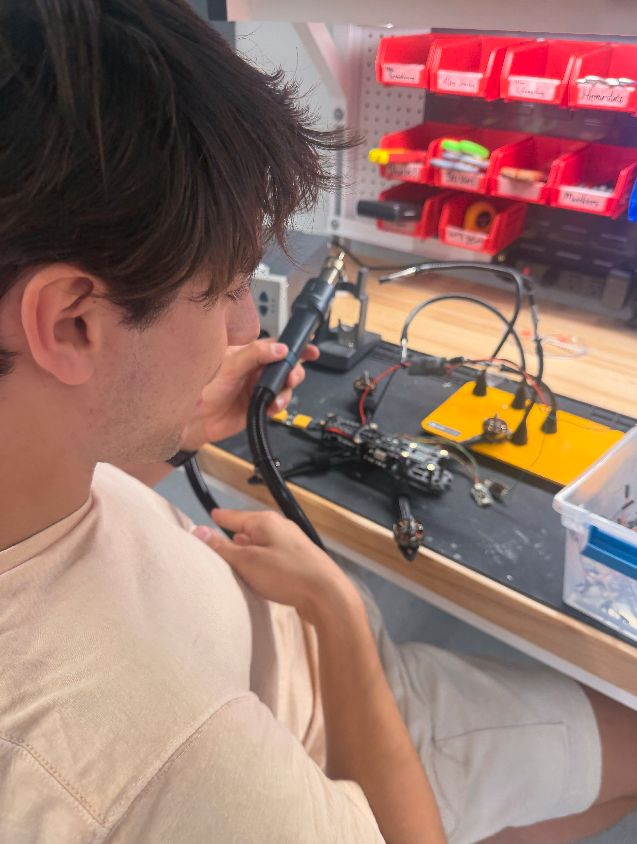

*Soldering at the bench (12:19 PM)*
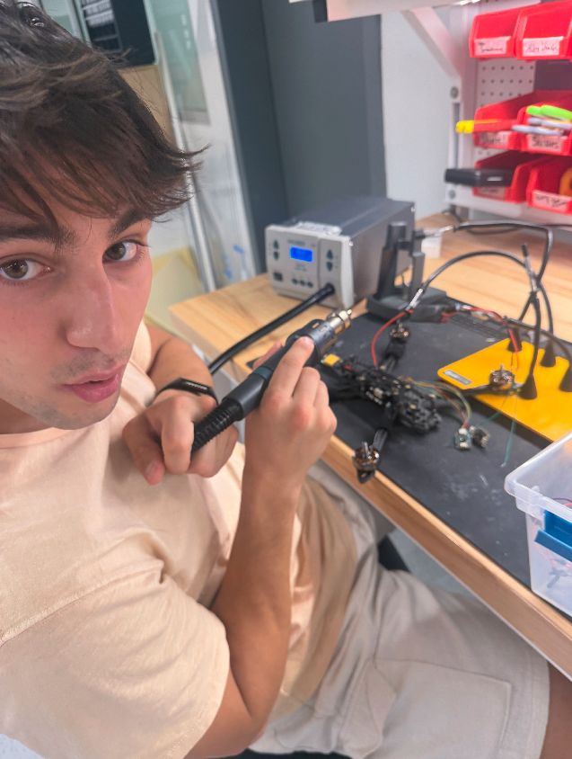

*Soldering at the bench (12:19 PM)*
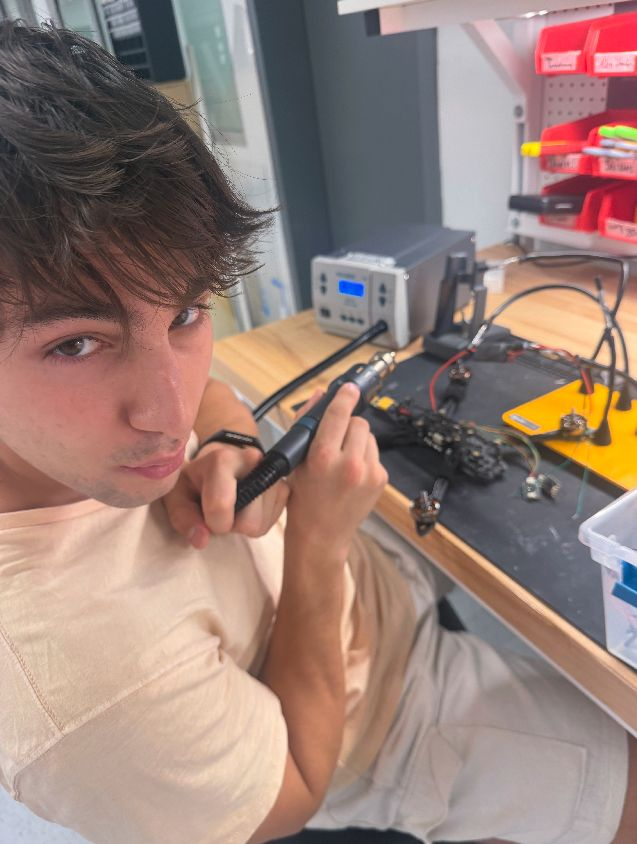

*Pi powered from the Rigol bench supply at 5.002 V (11:58 AM)*
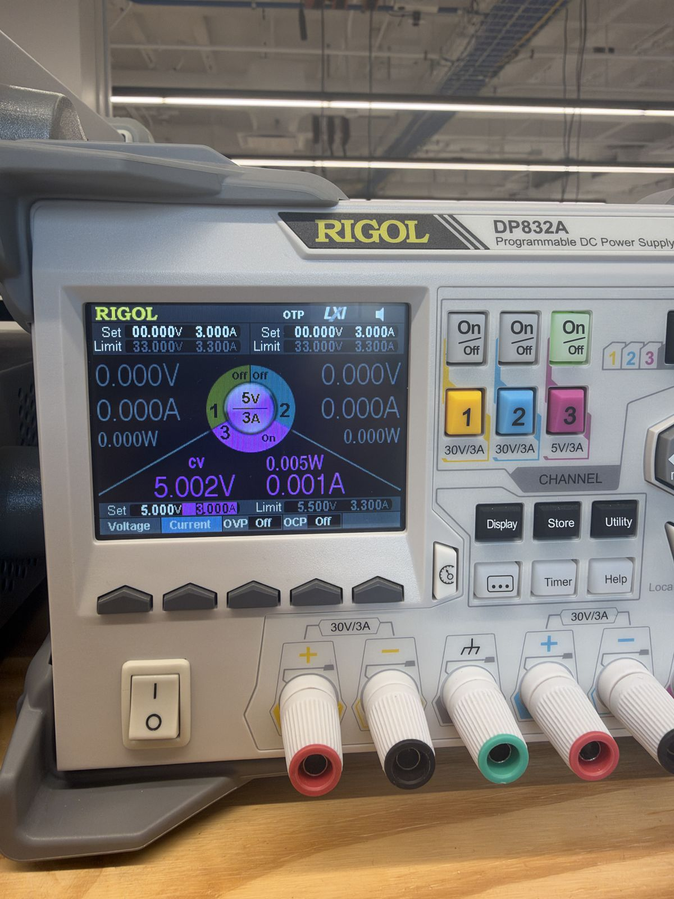

*Flight controller check (1:10 PM) (posted in #build_drone at 1:12 PM)*
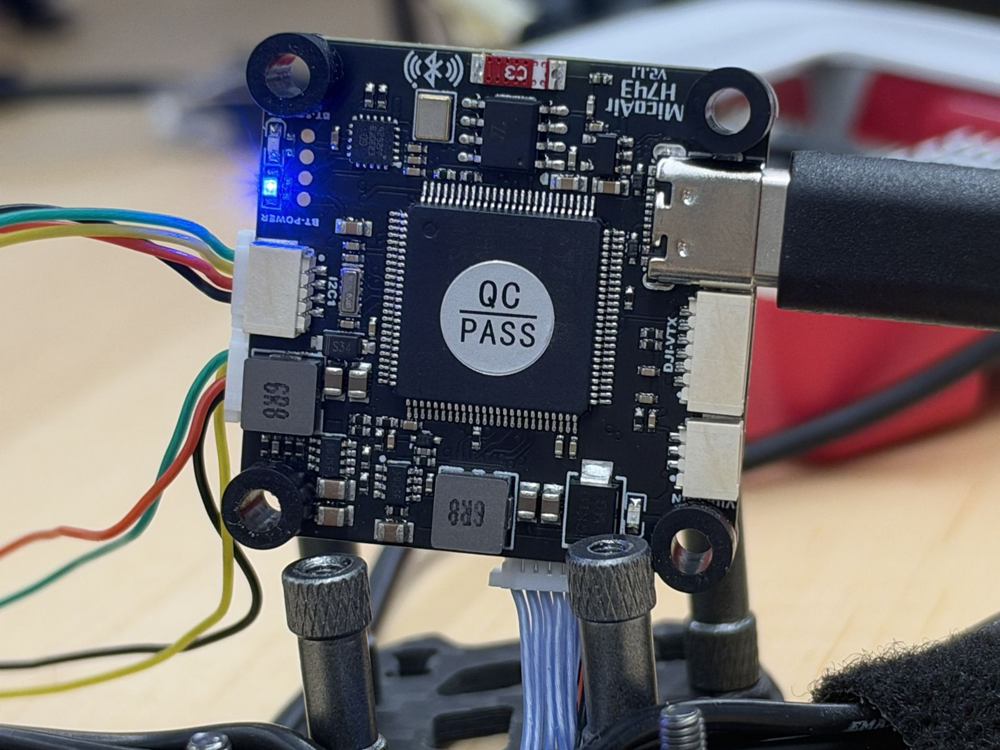

*Parts delivery tracking (12:23 PM)*
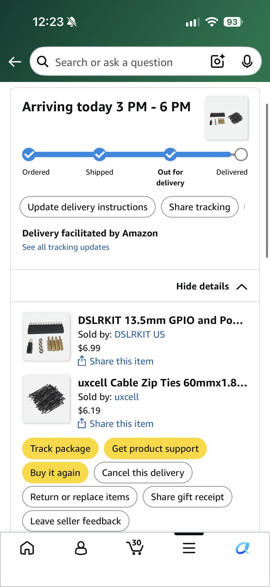

*GPIO header extenders and standoffs (12:24 PM)*
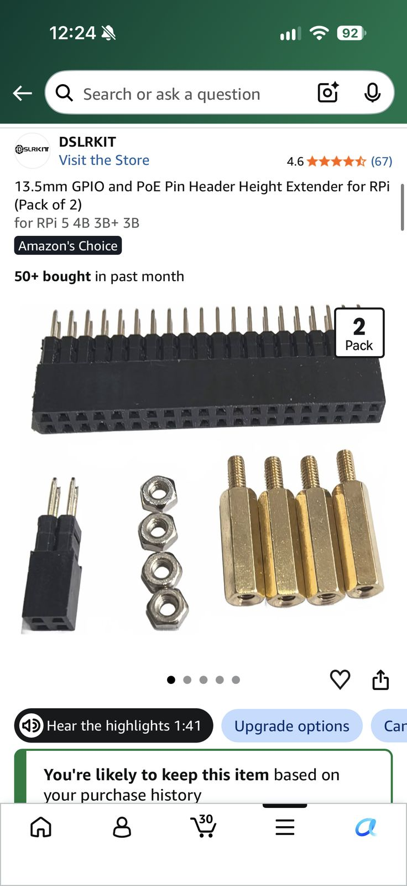

*Zip ties (12:24 PM)*
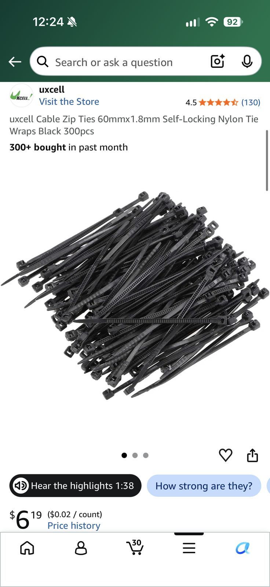

*DC barrel pigtail (12:24 PM)*
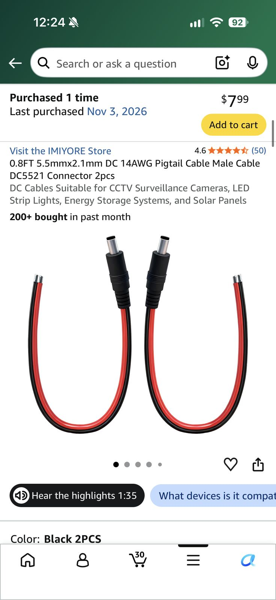

*USB-C pigtail (12:24 PM)*
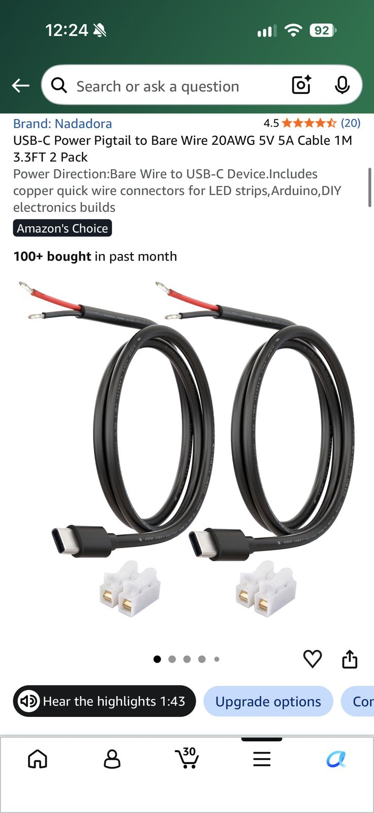

*FC with connectors (1:11 PM)*
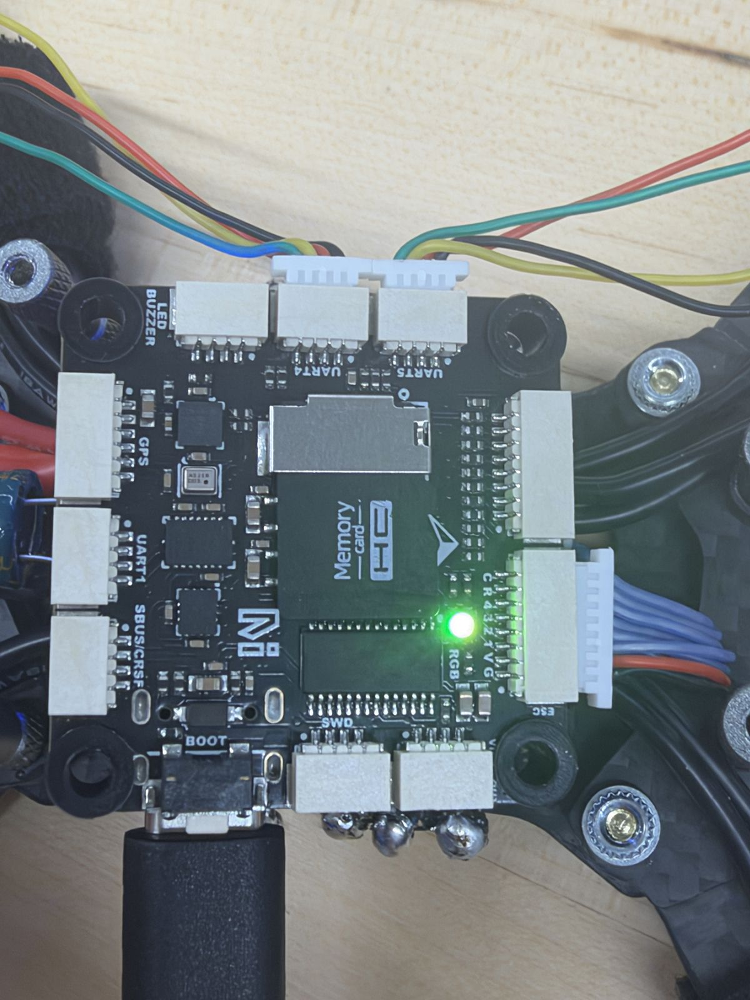

*QGroundControl parameters (1:13 PM)*
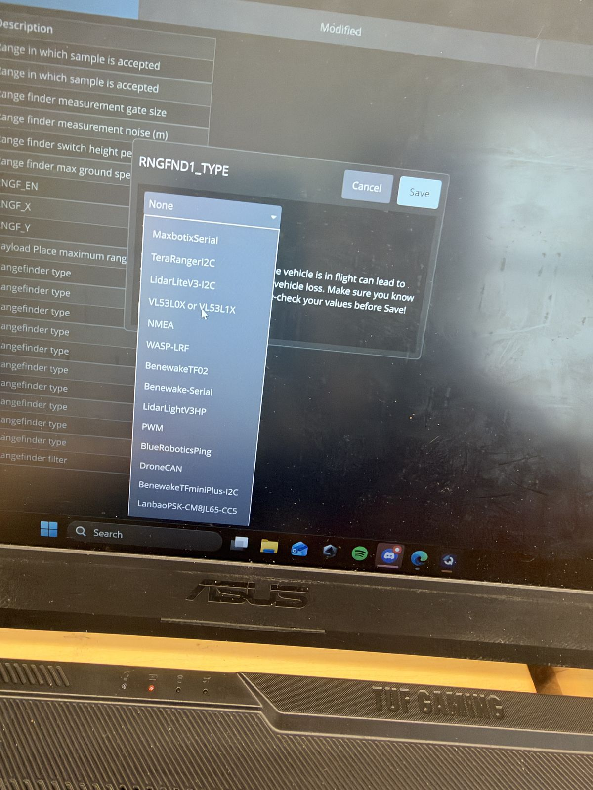

*Warren Cave map (11:54 PM)*
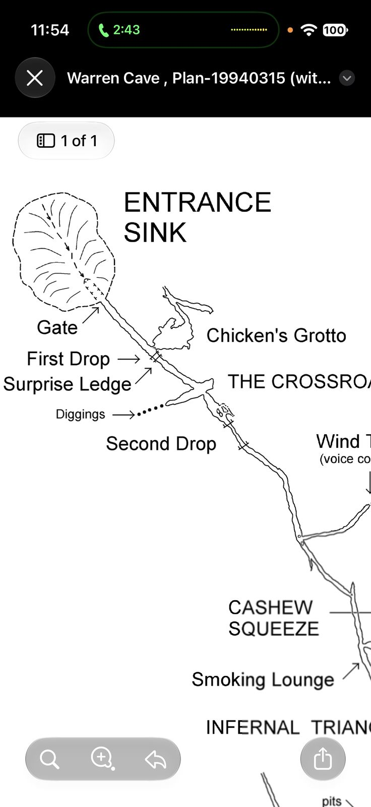

## Sources

- Discord #general, 2026-11-05 09:03–14:37 (aleqbr, gabe.bend, royboitoe), 23:57–23:58 (royboitoe)
- Discord #build_drone, 2026-11-05 13:12 (royboitoe), 13:14 (gabe.bend)
- Drive: `Tunnel Scout/Roberto_s Media/Pre 11_10/IMG_8934.JPG` – `IMG_8946.PNG` (EXIF 2026-11-05 11:58–23:54)
- Drive: `Tunnel Scout/Gabriel_s Media/Pre 11_10/IMG_0215.HEIC` – `IMG_0226.HEIC` (EXIF 2026-11-05 11:20–12:19), `IMG_8941.jpg`
- Fixed copies of the HEIC photos: `TunnelScoutArchiveProject/Fixed Pictures/Screenshot from 2026-11-12 19-29-53.png` – `19-30-38.png`
- Roberto's semester work report, pp. 8–9, 16–17 (Figs 89–98): [work report](../week-12-nov-09-to-nov-15/2026-11-10_tunnelscout-work-report-fall-2026.pdf)
