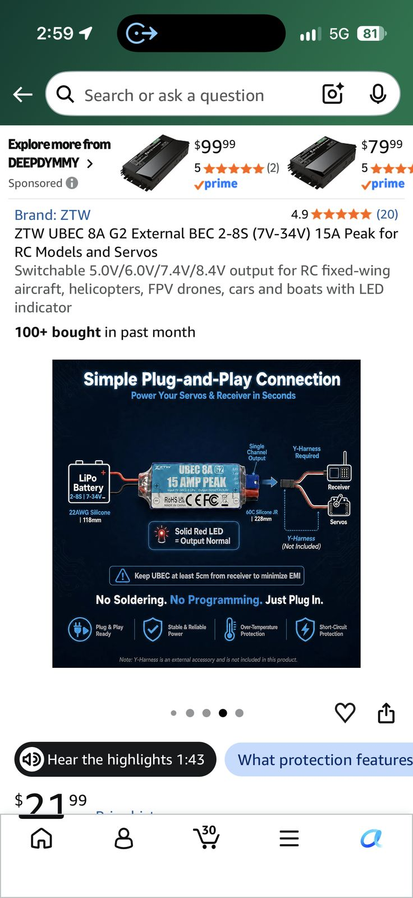
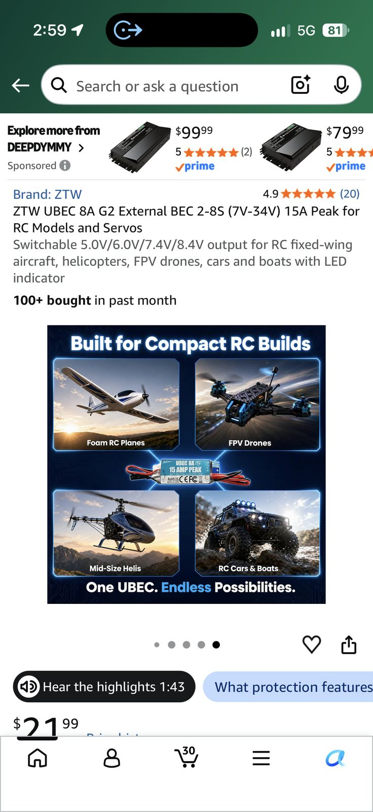
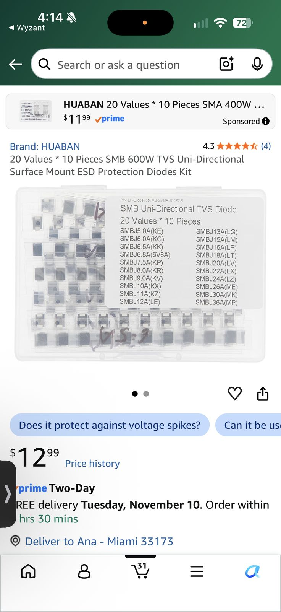
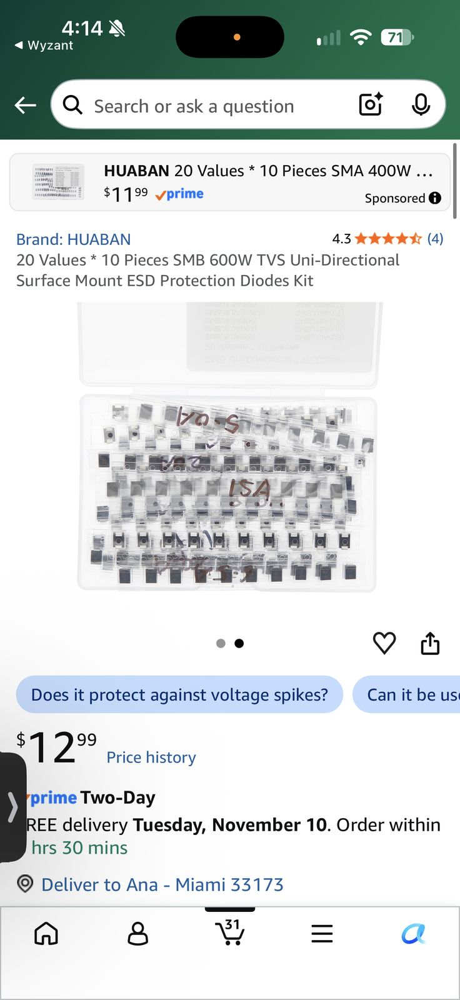

# Sunday, Nov 8

Roberto researched protection parts so the new BEC doesn't fail the same way.

## Roberto

- Researched BEC protection (2:06–3:50 PM): a TVS diode, an inline fuse, an anti-spark XT60 and a larger low-ESR ESC capacitor. Compared a ZTW UBEC and a TVS diode kit.
- Considered a 1S battery module for the Pi and rejected it (1.2 A max isn't enough for a Pi 5).
- Wrote the protection parts list email for the team.
- Shared two short videos on installing and understanding an external BEC (9:04–9:05 PM).

## Problems / what's next

- Planned protection: 1000 µF 50 V low-ESR capacitor, anti-spark XT60, inline fuse. TVS optional.

## Pics & files

- The research screenshots are product listings.

*ZTW UBEC listing (2:59 PM)*

*ZTW UBEC listing (2:59 PM)*

*TVS diode kit (4:14 PM)*

*TVS diode kit (4:14 PM)*

## Sources

- Discord #general, 2026-11-08 21:04–21:05 (royboitoe)
- Drive: `Tunnel Scout/Roberto_s Media/Pre 11_10/IMG_8990.PNG` – `IMG_8993.PNG` (EXIF 2026-11-08 14:59–16:14)
- Roberto's semester work report, pp. 9, 18, 23 (Figs 115–118): [work report](../week-12-nov-09-to-nov-15/2026-11-10_tunnelscout-work-report-fall-2026.pdf)
