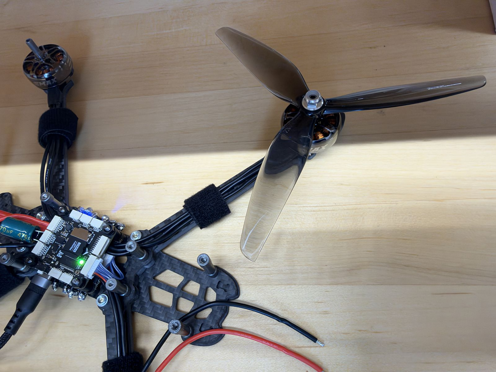
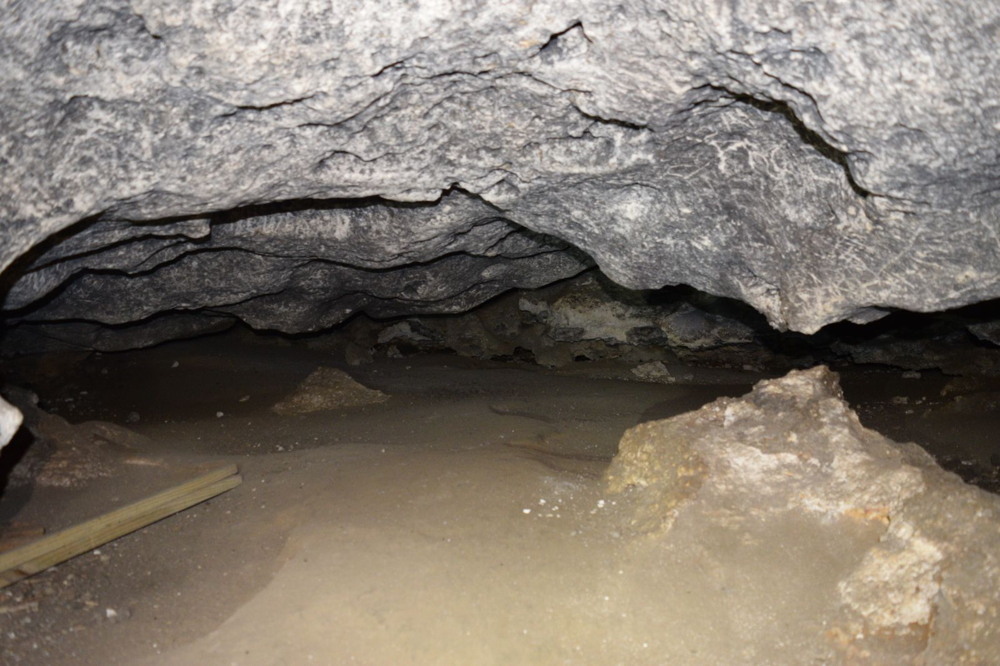

# Week 11 (Nov 2 – 8)

Build week.

- **Monday:** first day in the lab with everything. We set up the flight controller, flashed and booted the Pi, got in over SSH, and sent data laptop → fiber → Pi. Alex took the first camera picture.
- **Tuesday:** motors soldered and tested, drone assembled. The IR camera streamed live (Hope, then Gabriel from his Mac). Hope started the How-To Doc.
- **Wednesday:** Hope put the camera and ToF code, the How-To Doc and the parts list on GitHub, and we turned in the **Pre-Alpha**.
- **Friday:** first motor tests. The BEC died at 30% throttle with sparks and smoke. Roberto ordered a 55 V replacement and wrote up why it failed over the weekend.
- **Saturday:** team trip to **Warren Cave** to see the demo spot.

Things in Hope's write-ups that we can't pin to a single day this week:

- Figuring out the IR LED board's polarity (bench supply worked, Arduino pins didn't)
- Getting the VL53L1X distance sensor going on the Pi
- The collision-avoidance plan (the Pi sends distances to the FC)
- Programming and calibrating the FC with Roberto

Days: [Mon 11/2](2026-11-02.md) · [Tue 11/3](2026-11-03.md) · [Wed 11/4](2026-11-04.md) · [Thu 11/5](2026-11-05.md) · [Fri 11/6](2026-11-06.md) · [Sat 11/7](2026-11-07.md) · [Sun 11/8](2026-11-08.md)

*From Discord, git history, everyone's Drive photos, Gabriel's Claude chat reports, Hope's write-ups and Roberto's [work report](../week-12-nov-09-to-nov-15/2026-11-10_tunnelscout-work-report-fall-2026.pdf).*
