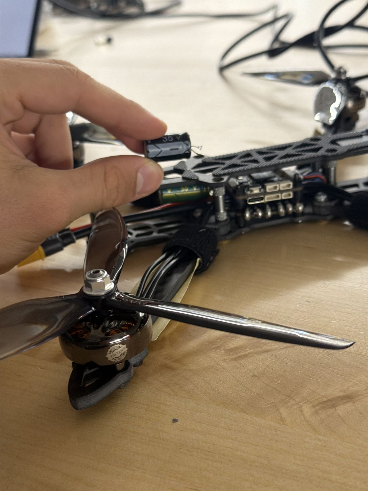

# Week 12 (Nov 9 – 15), so far

- **Monday: it flew!** Commands went Xbox → laptop → fiber → Pi → FC, and the drone lifted off on battery. It pitched forward and Roberto hit the kill switch, so now it's tuning.
- **Tuesday:** the lab manager and TA said all our work has to be tracked in GitHub. Gabriel set up how we'd do it, then spent the day on the lidar (blocked by a USB-C cable for now) and replaced a capacitor. Roberto wrote the [semester work report](2026-11-10_tunnelscout-work-report-fall-2026.pdf) and cleared the FC's sensor errors. Hope wrote up everything she'd done, and Alex pushed How-To Doc v2.
- **Wednesday:** Roberto set up the borrowed TBS Tango II as a joystick, practiced in a simulator, and sent everyone the flight plan.
- **Thursday:** Gabriel put in a lot of hours refactoring the GitHub. He cleaned up the folders, made weekly folders, and wrote a daily report for every day we worked, using the Discord, the Drive and our notes. All the Drive photos and cave videos are in the reports now, and the parts list is a spreadsheet. Hope pushed the first 3D model of the landing gear.
- **Friday:** the new BEC (Matek BEC12S PRO) came in. Gabriel bench tested it (a steady 5.26 V out at both 9 V and 22 V in), soldered on 18 AWG leads and an input capacitor, and covered it in heat shrink so it can't short against the carbon fiber frame. Re-tested at 22 V after soldering and it still read 5.26 V. The BEC pad diagram is now in [`docs/design`](../../docs/design/bec12s-pro-connections.png). See [Gabriel's log](2026-11-13_gabriel-daily-log.md).

Hope's write-ups also cover two things without specific days:

- The Pi ↔ FC link (MAVProxy, plus the QGroundControl "Drone Tether" connection and the Xbox controller). Sometime between the BEC failure on Nov 6 and Monday.
- Research on mapping the cave with the lidar (SLAM, ROS 2, HC-SR04 test rigs).

**Next up:** mount the soldered BEC on the drone and scope its input when the battery is plugged in. Set up the Tango in QGC, then retry the flight in AltHold. Alex is getting Ubuntu and ROS on the Pi.

Days: [Mon 11/9](2026-11-09.md) · [Tue 11/10](2026-11-10.md) · [Wed 11/11](2026-11-11.md) · [Thu 11/12](2026-11-12.md) · [Fri 11/13](2026-11-13_gabriel-daily-log.md)

*From Discord, git history, Roberto's daily logs, Gabriel's notes, photos and Claude chat reports (including the Nov 13 BEC bench notes), and Hope's write-ups.*
