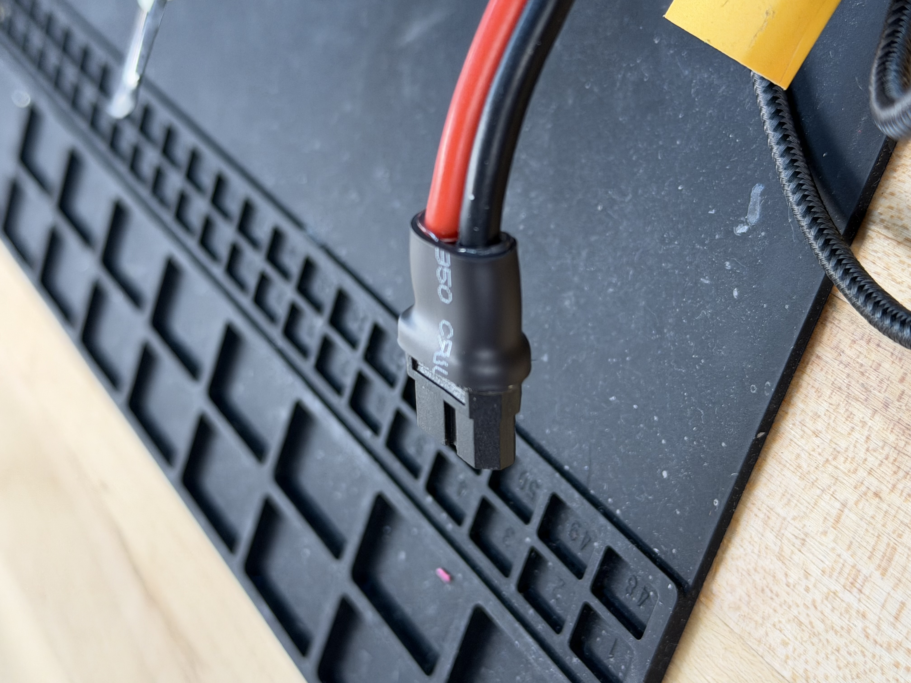
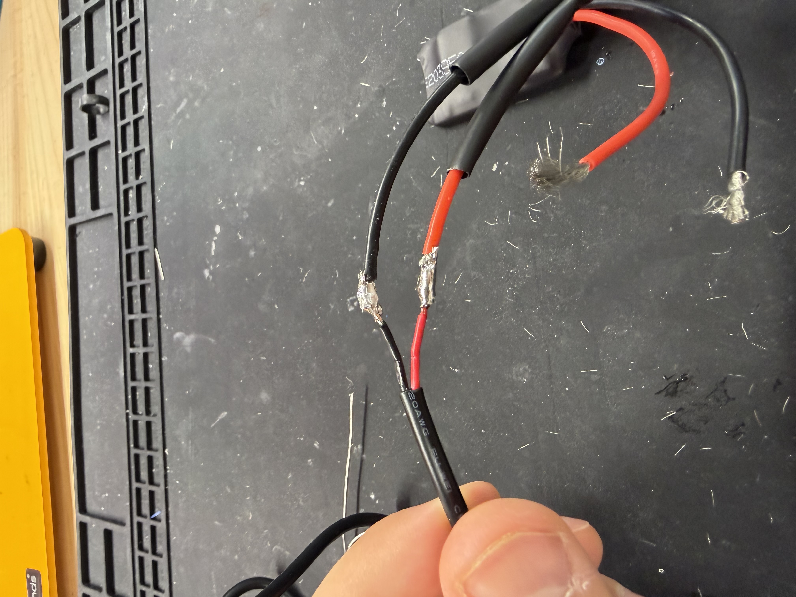
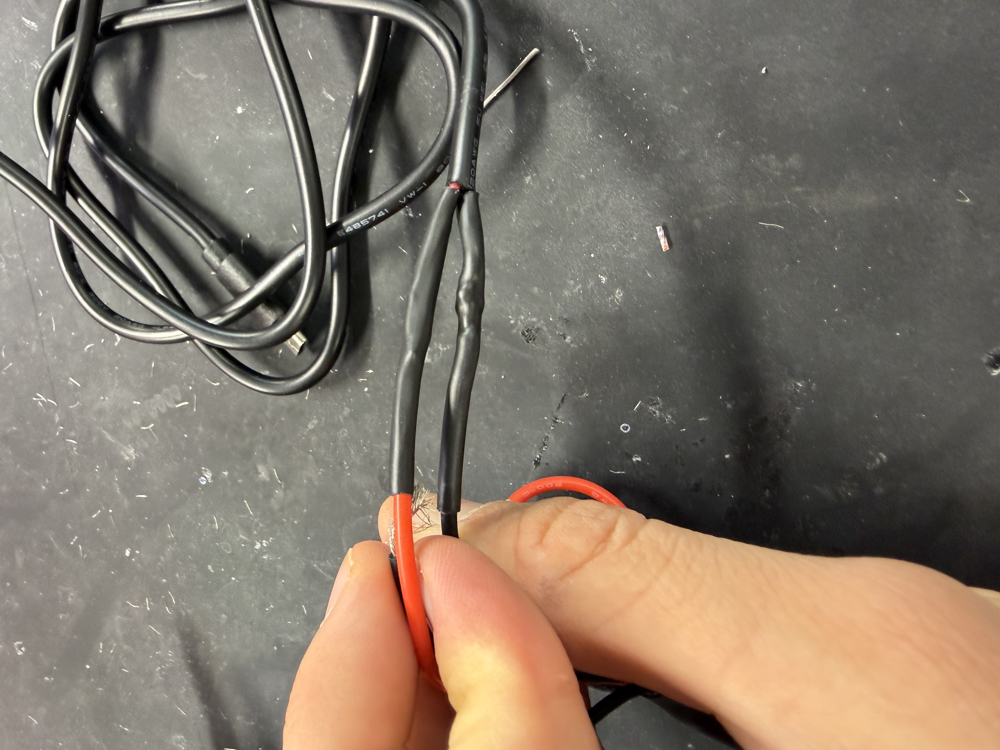

# Tuesday, Nov 17

Two quick wiring jobs today. Gabriel patched up the battery lead that got damaged during a flight test, then spliced the BEC output onto the USB-C cable that will power the Pi.

## Gabriel

- **Battery lead fix.** During a flight test the heat shrink on the battery's positive wire got cut open, right where it goes into the connector. A torn sleeve on the positive lead is how you end up with a short, so Gabriel slid a new piece of heat shrink over the connector end and shrunk it down. It's fully covered again.
- **BEC → USB-C for the Pi.** Soldered the BEC's 18 AWG output leads to a USB-C cable (20 AWG) so the Pi can take power straight from the BEC's 5.2 V rail. Red went to red and black to black. Each joint got its own heat shrink, and then a bigger piece went over both so the pair stays together.

## Problems / what's next

- Check polarity and voltage at the USB-C end with a meter **before** plugging it into the Pi.
- Load test with the Pi, lidar and camera all running, and check `vcgencmd get_throttled` for undervoltage.
- Mount the BEC on the drone off the carbon fiber, and scope its input when the 6S battery is plugged in.
- Go over the rest of the battery and power wiring for damage after each flight.

## Pics

Battery lead with the new heat shrink:

BEC output soldered to the USB-C wires, before heat shrink:

Done, with heat shrink over the joints:

## Sources

- Gabriel, Nov 17 (photos and notes)
