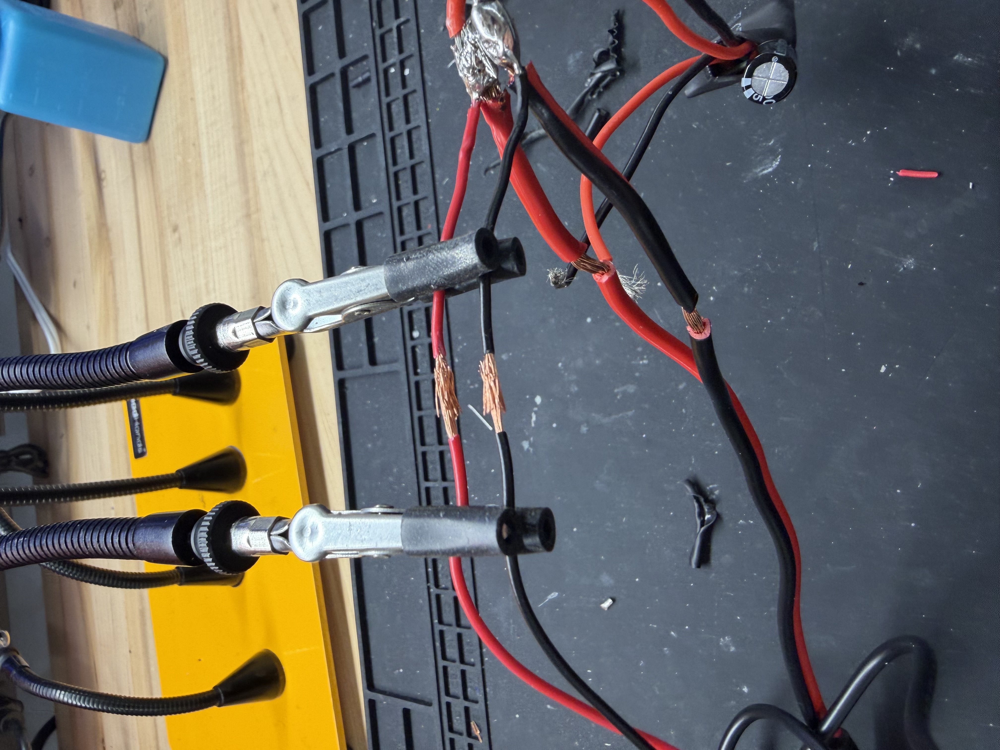
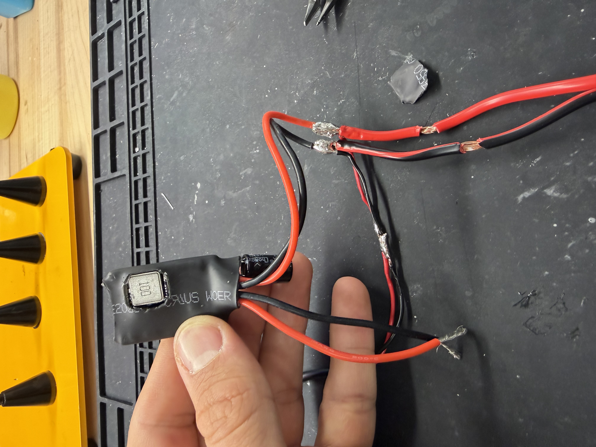
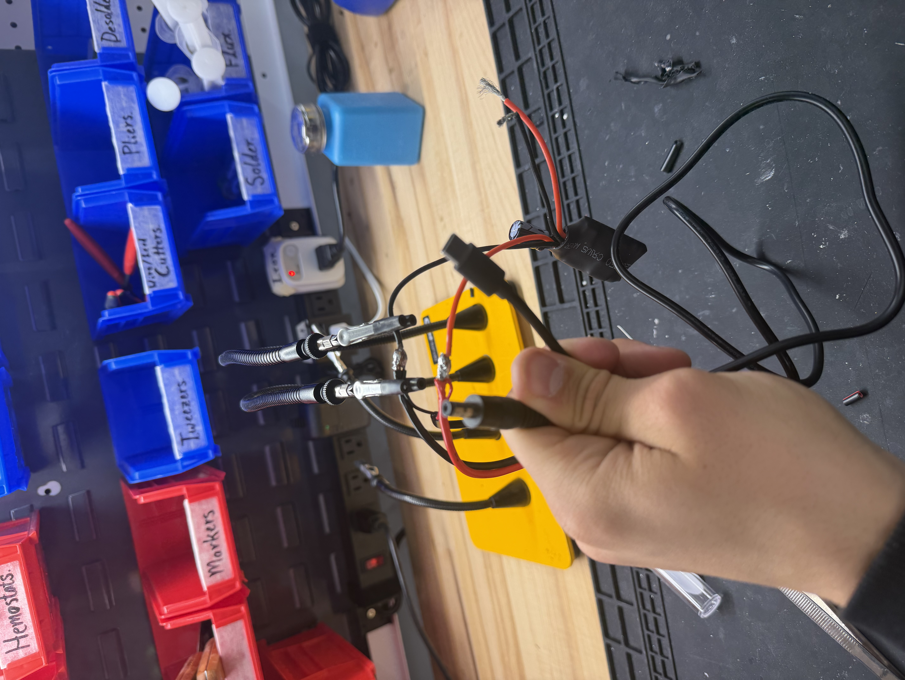
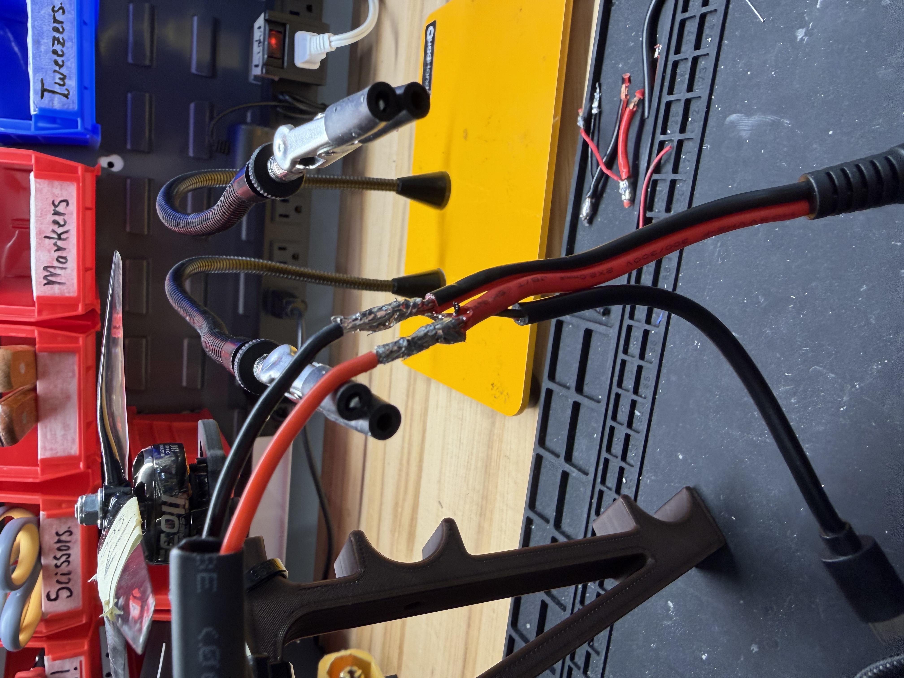
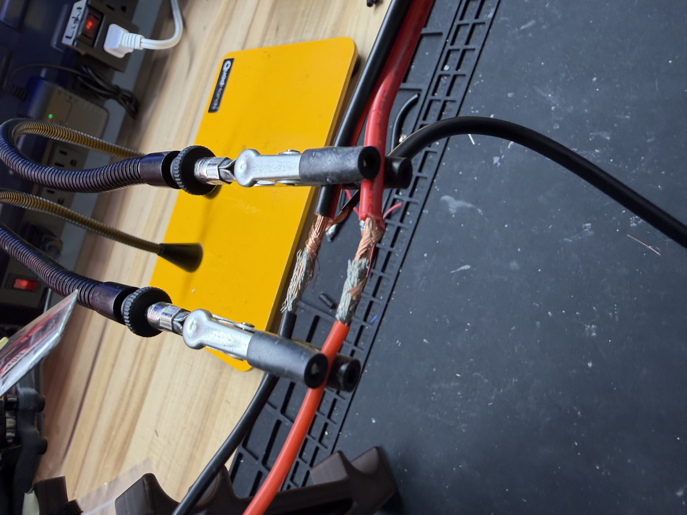
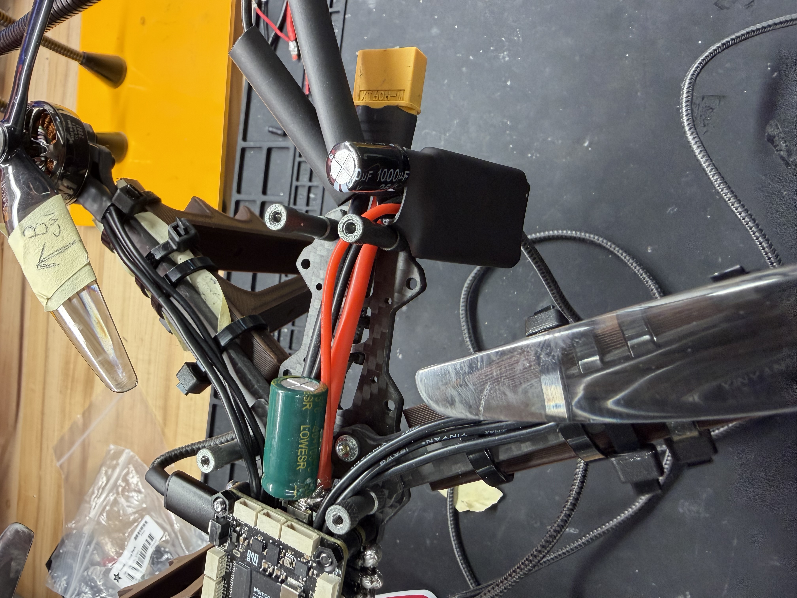
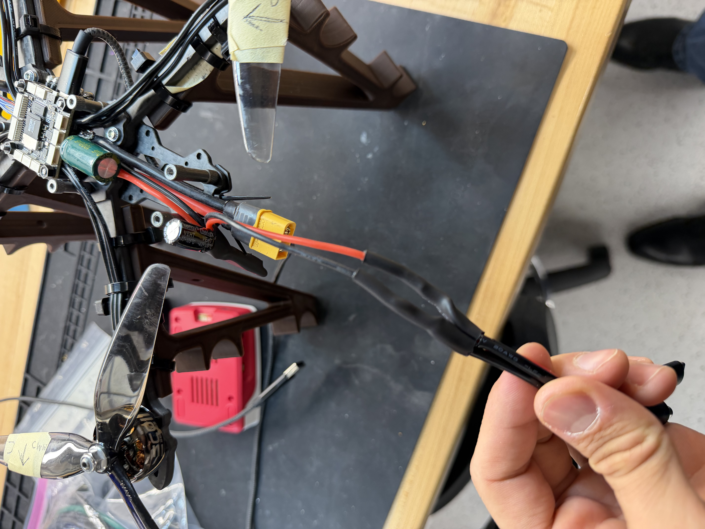

# Wednesday, Nov 18

The BEC harness is done and on the drone. Gabriel added the modem's power lead, checked the voltages with a meter, cut every wire to its final length, re-soldered it all, and then soldered the BEC to the drone's battery input.

## Gabriel

- **Modem power lead.** Soldered a second output onto the BEC to power the small Ethernet modem. That modem is what will link the fiber optic line into the system. The BEC now has two outputs: the USB-C lead for the Arduino and the barrel-plug lead for the modem.
- **Probe points and voltage check.** Stripped a small gap in the insulation on the output wires so a meter probe could reach the copper. Gabriel used these spots to confirm the right voltage was getting to the Arduino and the modem, and that both powered on.
- **Cut to length and re-soldered.** Once everything checked out, Gabriel cut all the soldered wires, trimmed them to the lengths needed for mounting the modem and Arduino on the drone, and soldered them back together. Every joint got heat shrink. The heat shrink over the BEC leaves the top component exposed so it can still shed heat.
- **BEC on the drone.** Soldered the finished BEC harness (Arduino USB-C lead + modem lead) to the drone at the battery connection, then heat shrunk those joints too.

## Problems / what's next

- Plug in the battery and meter both outputs again now that the BEC is fed from the drone's battery input, before connecting the Arduino or modem.
- Run the Arduino and modem together on the drone's power and watch for brownouts or resets.
- Mount the modem, Arduino and BEC on the frame and tie down the leads away from the props.
- Bring up the fiber link through the modem.

## Pics

Probe spots stripped on the output leads, before soldering:

BEC finished on the bench, with the probe spots on the leads (the top component is left uncovered by the heat shrink):

Modem power plug and Arduino USB-C lead both coming off the BEC:

Setting up the BEC-to-drone joint, before soldering:

BEC soldered to the drone:

Done, with heat shrink over the joints at the battery connection:

## Sources

- Gabriel, Nov 18 (photos and notes)
