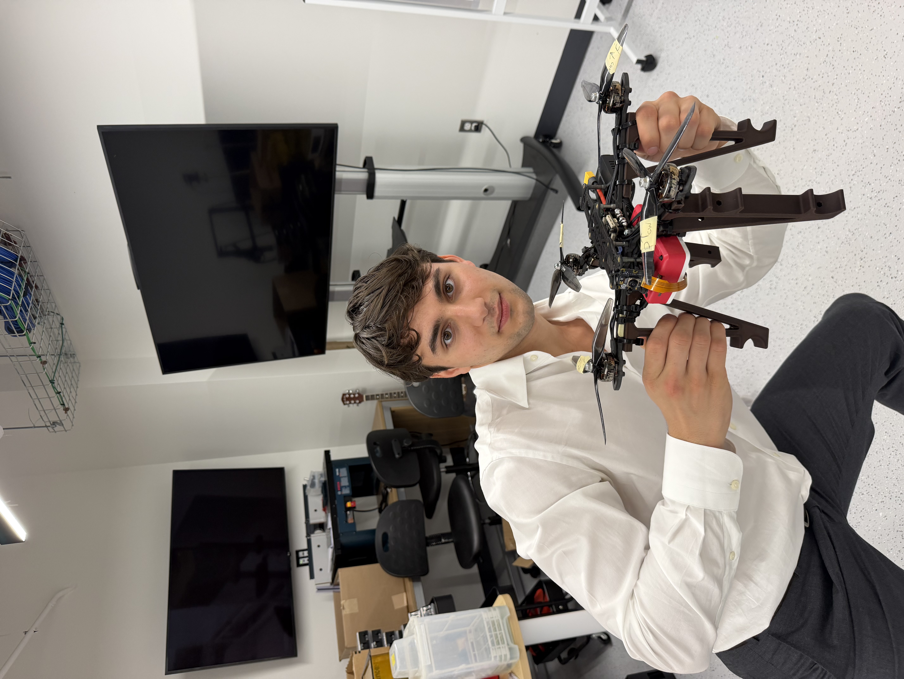
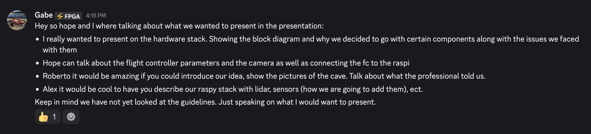

# Thursday, Nov 19

Today was a planning day. Hope, Roberto and Gabriel met up to go over where the drone stands and what to put first next semester. They traded ideas for new features and worked out who presents what in the prototype presentation.

## Gabriel, Hope, Roberto

- **Progress check.** Went over everything done on the drone this semester, up through this week's BEC harness (the USB-C lead for the Pi/Arduino and the modem power lead, both soldered to the drone's battery input). The camera is mounted and working.
- **Next semester priorities.** Talked about which work comes first next semester so the core system (power, flight controller, Pi and fiber link) is solid before new features go on.
- **Feature ideas.** Brainstormed upgrades, including:
  - a tank-style drive train so the scout can also drive along the tunnel floor
  - a camera that can turn 180°
  - and more ideas to keep looking into
- **Presentation split (most important).** Decided who presents which part of the prototype presentation (Gabriel posted the plan in Discord, screenshot in [docs/design/presentation_plan.png](../../docs/design/presentation_plan.png)):
  - **Gabriel:** the hardware stack. Shows the block diagram, why the team picked each component, and the problems hit with them.
  - **Hope:** the flight controller parameters, the camera, and connecting the FC to the Raspberry Pi.
  - **Roberto:** introduces the idea, shows the cave pictures, and covers what the professional told the team.
  - **Alex:** the Raspberry Pi stack with the lidar and sensors, including how the sensors will be added.

## Problems / what's next

- None of the team has read the presentation guidelines yet. The split is just what each person would like to present, so it may change once the guidelines are reviewed.
- Turn the feature ideas (tank drive train, 180° camera, etc.) into a prioritized list for next semester.

## Pics

Gabriel, in a suit, with the drone. The camera is mounted and working:

Presentation plan posted in Discord:

## Sources

- Gabriel, Nov 19 (notes and photo)
- Discord, Gabriel's 4:15 PM message on the presentation plan
